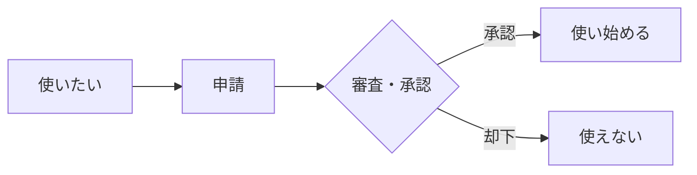
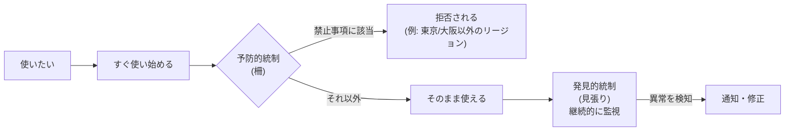

# 2. ネイティブ利用 — 段階4: AWSではどう実現するか

出典: [GCASガイド AWS技術ガイド(ガバナンス・セキュリティ / 予防的統制 / 発見的統制 / ユーザー管理)](https://guide.gcas.cloud.go.jp/aws)
カタカナの `/` は息継ぎ。ルールは [linking-rules.md](../../../linking-rules.md)。
「ガイド:」はGCASガイドに書かれていること、「推論:」は私の推論(ガイドには書かれていない)。

## 核心(原文)

> 原則として独自に共通的な機能・サービスを実装し提供することは行わず、可能な限りクラウドサービスをネイティブに利用することが出来る

AWSでは「ゲート」ではなく「ガードレール」で実現する。

### ゲートとガードレールの違い

### 図で見る

**ゲート型(従来)**: 使う前に毎回、関所を通る。

**ガードレール型(ガバメントクラウド)**: 最初から使い始める。柵(ガードレール)が危険な操作だけを止め、あとは見張りが監視する。

| | ゲート型 | ガードレール型 |
|---|---|---|
| 確認のタイミング | 使う前(毎回) | 使うとき(禁止事項だけ)と、使ったあと(監視) |
| 通れる範囲 | 承認されたものだけ | 禁止されたもの以外すべて |

| | ゲート型(従来・一般的な説明) | ガードレール型(ガバメントクラウド) |
|---|---|---|
| たとえ | 関所。通る前に毎回、審査と承認を受ける | 道路脇の柵。柵の内側なら自由に走れる |
| 進め方 | 事前に許可をもらってから使う | 最初から使い始め、危険な操作だけ止める |
| 止めるもの | 申請のないものすべて | 全アカウント共通の「最低限禁止すべきこと」だけ |
| 事後の対応 | 事前の審査が中心 | 発見的統制が継続的に監視して、通知・修正する |

**ガイド**: 原文は「従来のゲート型ではなく…ガードレール型」と対比しているだけで、ゲート型の中身や短所は書いていない。上の「ゲート型」の列は、一般的な意味での説明。

### なぜガードレール型なのか(推論)

ガイドは理由を書いていない。次は、ガイドの方針から**推論**したもの。

| 推論 | 根拠になるガイドの方針 |
|---|---|
| 毎回の審査は、使い始めを遅くする | 開発スピードの向上を、クラウド利用の効果に挙げている |
| 審査が増えると、独自のルールや機能が増えやすい | 独自の共通機能を作らず、クラウドをそのまま使う方針 |
| 事前審査だけでは、使い始めたあとの異常を拾えない | 発見的統制で継続的に監視する |

注意: ゲート型が常に悪いわけではない。ガードレール型は、禁止を「最低限」に絞る前提で成り立つ。禁止を増やすと、ゲート型に近づく(これも推論)。

> 従来のゲート型ではなく、予防的統制と発見的統制からなるガードレール型のガバナンス・セキュリティを提供する。
> クラウドサービスの利用にあたって制限となる内容は、ここに記述する予防的統制で設定される内容だけである。

## ガードレールの2種類(AWS)

| 種類 | 役割 | 使うAWSサービス |
|---|---|---|
| 予防的統制 | 不適切な操作を事前に止める | Organizations、SCP、Control Tower(予防コントロール) |
| 発見的統制 | 不正な状態を監視して通知・修正する | Security Hub、GuardDuty、Control Tower(発見コントロール)、Config Rules、環境の自動棚卸し |

## 予防的統制で止められる主なこと(AWS)

- 東京/大阪リージョン以外の使用
- IAMユーザーの永続的なアクセスキー作成(MFAを強制し、権限はIAMロールで管理)
- Adminユーザー以外によるIAM権限の付与
- セキュリティ/監査ログ関連サービスの削除
- AWS Marketplace、Outposts など一部サービス
- 一度の誤操作で高額請求になる購入(リザーブドインスタンス、Savings Plans など)

それ以外は、AWSのサービスをそのまま使える。

## 入口はひとつ: SSO → スイッチロール

1. GCASアカウントでシングルサインオン(IAM Identity Center経由)
2. 管理者以外は `SwitchOnlyRole`(スイッチロール専用)でAWSアカウントに入る
3. 利用システム側で作ったIAMロール(最小権限)へスイッチロール

## 5文で言ってみる

### 1 (ゲートでなくガードレール)
- **日本語訳**: ガバナンスは、ゲートではなくガードレールで行う。
- **English**: Governance uses guardrails, not gates.
- **カタカナ**: ガヴァナンスユーズィズ / ガードレイルズ / ナッゲイツ

### 2 (制限は予防的統制だけ)
- **日本語訳**: AWSを使うときの制限は、予防的統制だけ。
- **English**: The only limits on using AWS are the preventive controls.
- **カタカナ**: ジオウンリリミッツオンユーズィンゲイダブリューエス / アーザプリヴェンティヴコントロウルズ
- **なぜ?**
  - ガイド: 必要最小限のガバナンスとセキュリティ設定を除いて、独自の共通機能を作らず、クラウドのメリットを最大限使えるようにする方針。制限は「全てのアカウントに共通して最低限禁止すべき内容」に絞られ、予防的統制として設定される。
  - 推論: 制限を増やすと、ネイティブ利用から遠ざかる(ゲート型に近づく)。

### 3 (リージョン)
- **日本語訳**: 東京か大阪リージョンを使う。ほかは禁止。
- **English**: Use the Tokyo or Osaka region; others are blocked.
- **カタカナ**: ユーズザトウキョウオアオーサカリージョン / アザーズアーブロックト
- **なぜ?**
  - ガイド: 「利用者データの保管場所は国内リージョンに限定される」(生成AIも「国内リージョンで完結可能なモデルに限定」)。
  - 国内に限る理由の詳しい説明(法令・方針の根拠)は、今回読んだ範囲には書かれていなかった。
  - 推論: 東京と大阪の2つを許可しているのは、別の場所にあるリージョンを選べるようにするためかもしれない(ガイドには書かれていない)。

### 4 (アクセスキー)
- **日本語訳**: アクセスキーは作らず、MFAつきのIAMロールを使う。
- **English**: Don't create access keys; use IAM roles with MFA.
- **カタカナ**: ドウントクリエイトアクセスキーズ / ユーズアイエイエムロウルズ / ウィズエムエフエイ

### 5 (発見的統制)
- **日本語訳**: Security HubとGuardDutyが見張って、通知してくれる。
- **English**: Security Hub and GuardDuty watch your account and notify you.
- **カタカナ**: スィキュリティハバンガードデューティ / ウォチュアアカウント / アンノウティファイユー

> 補足(例外): アクセスキーが必要な外部SaaS連携などは、早い段階でキーを使わない方式を検討する。Marketplaceもマネージドサービスで代替できない場合のみデジタル庁に相談。

## AWSサービス名の読み

| English | カタカナ | 役割 |
|---|---|---|
| Control Tower | コントロールタワー | アカウント管理とコントロール |
| Organizations | オーガナイゼイションズ | 複数アカウントの組織管理 |
| SCP (Service Control Policy) | エスシーピー | 操作を制限するポリシー |
| IAM Identity Center | アイエイエムアイデンティティセンター | SSOの仕組み |
| Security Hub | スィキュリティハブ | セキュリティ検知の集約 |
| GuardDuty | ガードデューティ | 脅威検知 |
| Config | コンフィグ | 構成の記録と評価 |

## 語彙

| English | カタカナ | 日本語 | 詳しい説明 |
|---|---|---|---|
| guardrail | ガードレイル | ガードレール | 道路脇の柵のように、危険な操作だけを止める仕組み。範囲内では自由に使える |
| gate | ゲイト | ゲート | 関所のように、通る前に審査と承認を受ける従来のやり方 |
| preventive control | プリヴェンティヴコントロウル | 予防的統制 | 不適切な操作や設定を、事前に防ぐ(SCPなど)。実行しようとすると拒否される |
| detective control | ディテクティヴコントロウル | 発見的統制 | リソースが不正な状態になっていないか継続的に監視して、通知・修正する(Security Hubなど) |
| least privilege | リーストプリヴィリッジ | 最小権限 | 仕事に必要な最小限の権限だけを付与する考え方 |
| switch role | スウィッチロウル | スイッチロール | 最初のIAMロールから、別のIAMロールに切り替えて使う操作 |

[← ネイティブ利用へ戻る](../README.md)
