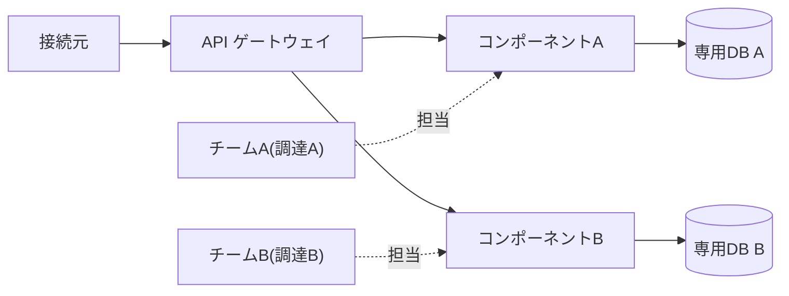

# 3. 単純移行で終わらせない — 補章: マイクロサービス

出典: [GCASガイド ガバメントクラウド概要解説「6.1.4 移行パターンR2でのアーキテクチャ見直し」](https://guide.gcas.cloud.go.jp/general) / AWS技術ガイド(運用・保守の知見: イベント駆動、コスト最適化)
英訳は筆者の訳(公式の英訳ではない)。カタカナの `/` は息継ぎ。ルールは [linking-rules.md](../../../linking-rules.md)。
「ガイド:」はGCASガイドに書かれていること、「推論:」は筆者の推論。

03の段階2〜4では、マイクロサービスを「活用する技術の1つ」として1行で触れただけだった。ガイドには、マイクロサービスだけを扱う節がある。この補章で、その中身を読む。

## マイクロサービスとは(原文)

> マイクロサービスとは、対象となるアプリケーションをコンポーネント分割して開発を行うアプローチやアーキテクチャを指し、システムをマイクロサービスアーキテクチャへ移行することによって以下のような利点が得られる。

**English(筆者訳)**: A microservice is an approach or architecture in which the target application is divided into components for development. Moving a system to a microservice architecture brings the following benefits.

R2(Rebuild)の「基本形1」。R2では、コンピュートにサーバレスかコンテナを使うことが前提(ガイド)。

## 4つの利点(ガイドの表6-1)

| 利点 | English | やさしい説明(ガイドの記述) |
|---|---|---|
| 高い変更容易性 | easy to change | コンポーネントが独立しているので、CI/CDと相性が良い。新機能のリリースも、戻す(ロールバック)のも簡単 |
| 開発サイクルの改善 | better development cycle | コンポーネントごとに小さなチームを作れる。理解が深まり、きめ細かな権限付与ができ、自発的で俊敏な開発になる |
| 高い耐障害性 | high fault tolerance | 1つのコンポーネントが故障しても、独立しているので、アプリ全体が止まるのを避けられる |
| 柔軟なスケール | flexible scaling | アプリ全体ではなく、負荷が高いコンポーネントだけを素早く増減できる。急な需要の増加にも対応できる |

ガイド: 従来は、リリースの調整コストが保守の人件費を増やす要因の1つだった。マイクロサービスだと、コンポーネントごとにチームを組み、デプロイするので、調整コストが下がると期待できる。

## 5つの基準(ガイドの表6-2)

「マイクロサービスアーキテクチャか」を企画の段階で仮に判断するための、便宜的な基準。

| # | 基準 | 補足(ガイド) |
|---|---|---|
| 1 | 何をマイクロサービス化するか、それを達成するコンポーネントを**構成図に示せる**こと | 用途の違う業務が混ざっていたら、環境単位で分ける |
| 2 | コンポーネントが**疎結合**で、**独立してデプロイできる**こと | 疎結合 = コンポーネントごとに別チームで開発・デプロイできる状態。実際にチームを分けるべき、という趣旨ではない |
| 3 | コンポーネント単位で調達が分かれている、または同じ調達でもチームやスプリントが分かれていて**並行開発できる**こと | 「そうできる状態」をマイクロサービスと呼ぶ。実際にやるべき、という趣旨ではない |
| 4 | 各コンポーネントの開発チームは**10人以下**であること | 同上 |
| 5 | 各コンポーネントが、**ビジネス側の体制分けに合う**こと | 行政機関職員という性質上、難しい場合は必ずしも守らない |

### 基準2〜5が満たせないとき(ガイド)

チーム体制やシステム要件とのトレードオフで難しい場合は、構成図のコンポーネントの上で、次の3点を明らかにして、見直しに向けて計画する。

- 具体的に達成できていない箇所
- トレードオフの背景と内容
- どういう契機で、どの方向に見直すか

### 構成例(ガイドの図6-3)

ガイド: この例では、アプリをコンポーネントAとBに分け、それぞれが専用のデータベースを持つ。コンポーネント間はAPIで連携して、疎結合にしている。外部のシステムとも連携する。開発体制も、チームAとチームBに分かれる。

## マイクロサービスにしない場合(ガイド)

| 場合 | ガイドの記述 |
|---|---|
| 共通機能やデータを、複数のシステムに提供するシステム(API連携基盤、認証基盤、データ連携基盤、データレイクなど) | 必ずしもマイクロサービスが相応しいとは限らない。管理用の画面などがあるなら、基本形1・2に沿う。画面が全くなくて、マイクロサービスも合わない場合は、基本形2のバックエンドに準じて、適切な粒度で機能を分ける |
| 基本形2(フロントエンド・バックエンド分離) | 画面(フロント)と処理(バック)をAPIで分ける。再利用性、開発規模の適正化、変更容易性、通信量とサーバ負荷の軽減、の4つの利点 |
| R2の例外: 長期塩漬けシステム | 移行の整備費用が**1,500万円以下**を目安とし、改修は脆弱性やバグの修正に限られて、外的要因による改修が想定されない。統廃合の時期などを明確にして、現行基盤を維持する、またはSaaS・共通機能の利用を検討する |
| R2の例外: 運用経費が極小のシステム | 移行前の年間の運用経費が**400万円以下**。今後の統廃合やSaaS・共通機能の利用を目指していて、プロジェクト計画書に方針と時期が書かれている。金額は目安で、数万円の高低を見る趣旨ではない |

## AWSで実現するときの知見(ガイド)

### 1. コンテナは、ステートレスでイミュータブルに

- ステートレス: 状態やコンテナ固有の情報をイメージに入れない。セッション情報などは外に保存する。
- イミュータブル: コンテナは変更しない。バージョンアップやパッチは、イメージを作り直してコンテナを作り直す。
- 効果: コンテナの可搬性が高まり、CI/CDでのデプロイの自動化や、リクエストの変動に応じた追加・削除が簡単になる。

### 2. バッチを、イベント駆動のマイクロサービスに

ガイドには、従来のバッチ処理を、イベント駆動のマイクロサービスにする2つの例がある。

| 実装例 | 流れ | ガイドの説明 |
|---|---|---|
| SNS + SQS + Lambda | リクエスト側が SNS のトピックに発行 → SQS が購読 → Lambda 関数が呼ばれる | 従来のバッチは Lambda 関数として実装する。ただし「マイクロサービスとなるように役割を決めて実装する」ことを推奨。複数の SQS が購読していれば、並列に実行(ファンアウト)できる |
| EventBridge + Lambda | リクエスト側が EventBridge のイベントバスにイベントを発行 → イベントターゲット(支払、注文などの Lambda で書かれたマイクロサービス)が動く | ロジックを意識せずにサービスを結合できて、疎結合になる |

ガイド: どちらも、リクエスト側は「発行するだけ」でよい。
ガイド: イベント駆動の代表的なパターンとして、コレオグラフィ(指揮者のいない、サービス同士の連携)、CQRS(参照と更新の分離)、イベントソーシング(すべての操作を記録)がある。

### 3. コンテナは、適切な単位で分ける

- ガイド(コスト最適化の表): ECS/Fargate では、「業務特性やピーク特性を考慮して、最適な単位でコンテナを分割する」。
- ガイド(同表): 同期でマイクロサービスを呼び出す場合、遅いサービスがあると呼び出し元も遅くなる。X-Ray で、時間がかかっているコンポーネントを特定して直す。

## ガイドが書いていないこと

- マイクロサービスの**粒度**(どこまで細かく分けるか)の決め方。
- データの整合性(複数のコンポーネントにまたがる更新)の取り方。
- 具体的な**分割の手順**。
- 推論: 基準はすべて「そうできる状態か」を問う形で、実際に分割する手順は示されていない。分割の進め方は、別の資料や自分たちのシステムに合わせて検討が必要。

## 5文で言ってみる

### 1 (定義)
- **日本語訳**: アプリケーションを、独立したコンポーネントに分ける。
- **English**: Split the application into independent components.
- **カタカナ**: スプリットジアプリケイションイントゥ / インディペンデントコンポーネンツ

### 2 (基準2)
- **日本語訳**: コンポーネントはAPIで連携し、独立してデプロイできる。
- **English**: Components talk through APIs and deploy independently.
- **カタカナ**: コンポーネンツトークスルーエイピーアイズ / アンディプロイインディペンデントリ

### 3 (耐障害性)
- **日本語訳**: 1つのコンポーネントが故障しても、アプリ全体は動き続ける。
- **English**: One component fails, but the whole application stays up.
- **カタカナ**: ワンコンポーネントフェイルズ / バットザホールアプリケイションステイズアップ

### 4 (柔軟なスケール)
- **日本語訳**: 忙しいコンポーネントだけを、増やす。
- **English**: Scale only the busy component.
- **カタカナ**: スケールオンリザビジーコンポーネント

### 5 (イベント駆動)
- **日本語訳**: イベントを発行して、小さなサービスに処理させる。
- **English**: Publish an event and let small services react.
- **カタカナ**: パブリシャニヴェント / アンレットスモールサーヴィスィズ / リアクト

## 語彙

| English | カタカナ | 日本語 | 詳しい説明 |
|---|---|---|---|
| component | コンポーネント | コンポーネント | アプリを分けたときの、1つ1つの部品 |
| loosely coupled | ルースリーカプルド | 疎結合 | 部品同士の依存が弱く、1つを変えても他に影響しにくい状態 |
| deploy | ディプロイ | デプロイ | 作ったアプリを、動かせる環境に配置すること |
| rollback | ロールバック | ロールバック | 変更前の状態に戻すこと |
| fault tolerance | フォールトトレランス | 耐障害性 | 一部が故障しても、全体が動き続けられる性質 |
| scale out / scale up | スケールアウト / スケールアップ | 台数を増やす / 性能を上げる | 負荷に合わせて、処理能力を増やすこと |
| fan-out | ファンアウト | ファンアウト | 1つのメッセージを、複数の処理に同時に配ること |
| stateless | ステートレス | ステートレス | 状態を持たないこと。どのサーバが処理しても同じ結果になる |
| immutable | イミュータブル | イミュータブル | 作ったら変更せず、変えるときは作り直すこと |

[← 単純移行で終わらせないへ戻る](../README.md)
