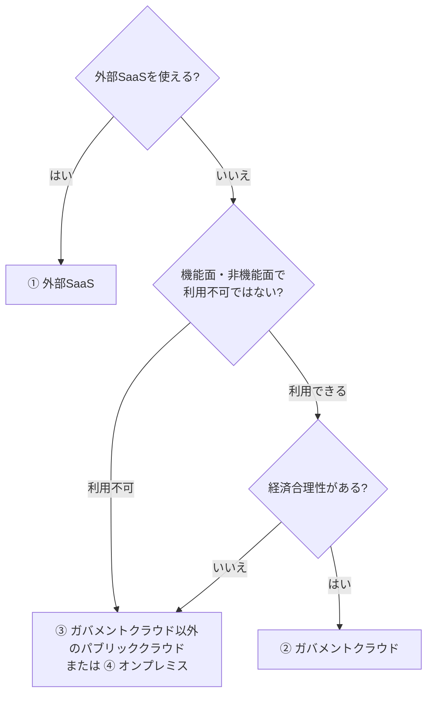

# 5. SaaSは無条件の正解ではない — 段階2: 原文を読み解く

出典: [GCASガイド ガバメントクラウド概要解説「4.1 利用検討の基本的な考え方」「6.1 モダンアプリケーション化」](https://guide.gcas.cloud.go.jp/general)
英訳は筆者の訳(公式の英訳ではない)。カタカナの `/` は息継ぎ。ルールは [linking-rules.md](../../../linking-rules.md)。
「ガイド:」はGCASガイドに書かれていること、「推論:」は筆者の推論。

## 原文を1文ずつ読む

### 6.1 モダンアプリケーション化(核心)

| # | 原文 | English(筆者訳) | ポイント |
|---|---|---|---|
| 1 | モダンアプリケーション化の検討において、SaaS利用は開発量の削減に繋がるため強く推奨される。 | In considering application modernization, using SaaS is strongly recommended because it leads to less development. | まず「強く推奨」。理由は「開発量の削減」。`lead to ...`(〜に繋がる) |
| 2 | ただし、SaaS利用が無条件に推奨されるわけではない。 | However, SaaS is not recommended unconditionally. | `However`(ただし)で逆接。`unconditionally`(無条件に) |
| 3 | 利用者数の段階的な増加が見込まれる場合等、運用段階でSaaS利用料が高額となるケースもあるため、ライフサイクルコストの観点から真にコスト削減効果が発現するかを慎重に評価する必要がある。 | In some cases, such as when the number of users is expected to increase gradually, SaaS fees become high in the operation phase, so it is necessary to evaluate carefully, from a lifecycle-cost viewpoint, whether the cost reduction truly materializes. | 注意する場面は「利用者数が増える」とき。`truly materializes`(真に発現する) |
| 4 | 例えば、SaaSと同様の機能をマネージドサービスで実現することが可能であれば、ライフサイクルコストの観点から両方式を比較して十分に評価すべきである。 | For example, if the same functions as SaaS can be realized with managed services, both approaches should be compared and thoroughly evaluated from a lifecycle-cost viewpoint. | 比べる相手は「マネージドサービス」。`should be ...`(〜すべきである) |

### 4.1.1 外部SaaSの利用

| # | 原文 | English(筆者訳) | ポイント |
|---|---|---|---|
| 5 | 長期間(2〜3年)同じ外部SaaSを利用している場合にあっては、最新のSaaS市場の動向やコスト構造等を検証し、…利用環境の再検討を行うこと。 | If you have used the same external SaaS for a long time (two to three years), examine the latest market trends and cost structure, and reconsider the usage environment. | 見直しの目安は「2〜3年」。`cost structure`(コスト構造) |

## 検討フロー(ガイドの図4-1)

## 読み解きのポイント

- ガイド: 外部SaaSは、検討の最初の選択肢(図4-1の最初の判定)。扱う業務の効率化に役立つ外部SaaSがあるなら、「積極的に採用すること」。
- ガイド: ただし、無条件ではない。注意するのは、利用者数が段階的に増えるとき。運用段階でSaaS利用料が高くなることがある。
- ガイド: 評価の物差しは「ライフサイクルコスト」。導入のときだけでなく、運用段階までの費用の合計で見る。
- ガイド: 同じ機能をマネージドサービスで作れるなら、SaaSとマネージドサービスの両方をライフサイクルコストで比べる。
- ガイド: 同じ外部SaaSを2〜3年使い続けているときは、市場の動向やコスト構造を確認して、環境を再検討する。
- 推論: 「強く推奨」と「無条件ではない」は矛盾しない。SaaSはまず検討する第一候補で、そのあとに費用の面で確認する、という二段構えだと読める。
- 推論: 利用者数が増えると料金が上がるのは、SaaSの料金が利用者数などに応じて変わる場合があるからだと考えられる。ガイドは料金の仕組みまでは書いていない。

## 5文で言ってみる

### 1 (文1)
- **日本語訳**: SaaSは開発量を減らせるので、強く推奨される。
- **English**: SaaS reduces development, so it is strongly recommended.
- **カタカナ**: サースリデュースィズディヴェロプメント / ソウイリズストロングリレコメンディッド

### 2 (文2)
- **日本語訳**: ただし、SaaSは無条件に推奨されるわけではない。
- **English**: But SaaS is not recommended unconditionally.
- **カタカナ**: バッサースイズナット / レコメンディッドアンコンディショナリー

### 3 (文3)
- **日本語訳**: 利用者が増えると、料金が上がることがある。
- **English**: Fees may grow as users increase.
- **カタカナ**: フィーズメイグロウ / アズユーザーズインクリース

### 4 (文4)
- **日本語訳**: SaaSとマネージドサービスを、ライフサイクルコストで比べる。
- **English**: Compare SaaS and managed services by lifecycle cost.
- **カタカナ**: コンペアサースアンマニジドサーヴィスィズ / バイライフサイクルコスト

### 5 (文5)
- **日本語訳**: 長く使っているSaaSは、2〜3年ごとに見直す。
- **English**: Review a long-used SaaS every two to three years.
- **カタカナ**: リヴューアロングユーズドサース / エヴリトゥーツースリーイヤーズ

## 語彙

| English | カタカナ | 日本語 | 詳しい説明 |
|---|---|---|---|
| SaaS (Software as a Service) | サース | SaaS | ソフトウェアをサービスとして使う形態。自分でアプリを開発しなくてよい |
| lifecycle cost | ライフサイクルコスト | ライフサイクルコスト | 導入から運用、廃止までにかかる費用の合計 |
| unconditionally | アンコンディショナリー | 無条件に | 条件をつけずに、いつでもそうする、ということ |
| evaluate | イヴァリュエイト | 評価する | 良い点と悪い点を調べて、判断すること |
| managed service | マニジドサーヴィス | マネージドサービス | サーバの管理をクラウド事業者に任せられるサービス |
| usage fee | ユーセイジフィー | 利用料 | サービスを使うたびにかかる料金 |

[← SaaSは無条件の正解ではないへ戻る](../README.md)
