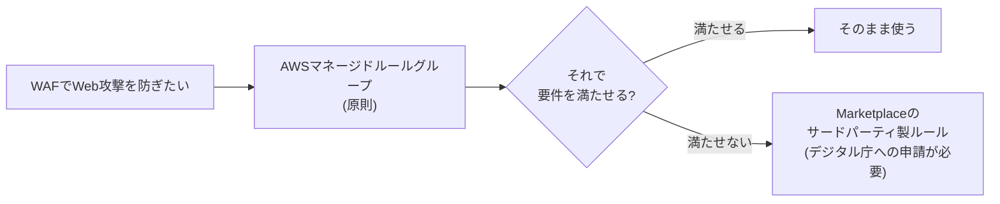

# 5. SaaSは無条件の正解ではない — 段階4: AWSではどう実現するか

出典: [GCASガイド AWS技術ガイド「予防的統制」](https://guide.gcas.cloud.go.jp/aws) / リファレンスアーキテクチャ(AWS) / 公共SaaS向けガイド
カタカナの `/` は息継ぎ。ルールは [linking-rules.md](../../../linking-rules.md)。
「ガイド:」はGCASガイドに書かれていること、「推論:」は筆者の推論。

AWS特有の記述は多くない。あるのは、SaaSやサードパーティ製品を **AWS Marketplace** から入手する場合の扱い。

## AWS Marketplace の扱い

| 場面 | ガイドの記述 |
|---|---|
| 予防的統制(AWS) | AWS Marketplace の利用は「原則禁止」。マネージドサービスや他製品で代替できない場合は、デジタル庁に相談する |
| 公共SaaSの要件 | 「CSPが提供するマーケットプレイスの利用は保管金制度の制約から不可」 |
| WAFのルール(リファレンスアーキテクチャ) | AWSマネージドルールグループの使用が原則。システムの特性上それで満たせない場合のみ、Marketplaceのサードパーティ製のルールグループも許容される。ただし、デジタル庁への申請が必要 |

## 具体例: WAFのルール

- ガイド: まずAWSのマネージドな仕組みを使う。サードパーティ製は、それで満たせないときだけ。
- 推論: 学習ノートの核心「SaaSは無条件の正解ではない」と同じ形。外部の製品は第一候補になるが、無条件には選べない。ここでは「まずAWSのマネージドサービス」が先に来る。
- 推論: 外部SaaSを直接契約する場合(4.1.1の①)と、AWS Marketplace経由で入手する場合は、別の経路として扱われていると読める。ガイドは、両者の関係を1つの文で整理してはいない。

## 4文で言ってみる

### 1
- **日本語訳**: AWS Marketplaceは、原則禁止。
- **English**: AWS Marketplace is prohibited in principle.
- **カタカナ**: エイダブリューエスマーケットプレイスイズ / プロヒビティディンプリンスィプル

### 2
- **日本語訳**: 代わりに、マネージドサービスや他の製品を使う。
- **English**: Use managed services or other products instead.
- **カタカナ**: ユーズマニジドサーヴィスィズ / オアアザープロダクツインステッド

### 3
- **日本語訳**: WAFでは、まずAWSのマネージドルールグループを使う。
- **English**: Use AWS managed rule groups first.
- **カタカナ**: ユーズエイダブリューエスマニジドルールグループス / ファースト

### 4
- **日本語訳**: サードパーティのルールには、デジタル庁への申請が必要。
- **English**: Third-party rules need approval from the Digital Agency.
- **カタカナ**: サードパーティルールズ / ニードアプルーヴァル / フロムザデジタルエイジェンスィ

## 語彙

| English | カタカナ | 日本語 | 詳しい説明 |
|---|---|---|---|
| AWS Marketplace | エイダブリューエスマーケットプレイス | AWSマーケットプレイス | AWSの上で、サードパーティの製品やSaaSを購入できる場所 |
| third-party | サードパーティ | サードパーティ | AWSでも利用組織でもない、第三者の事業者が作った製品 |
| managed rule group | マニジドルールグループ | マネージドルールグループ | WAFの攻撃検知ルールを、まとめて提供してくれるもの |
| WAF (Web Application Firewall) | ワフ | WAF | Webアプリへの攻撃を防ぐ仕組み |
| approval | アプルーヴァル | 承認、申請に対する許可 | 実行してよいと、権限のある側から認められること |

[← SaaSは無条件の正解ではないへ戻る](../README.md)
