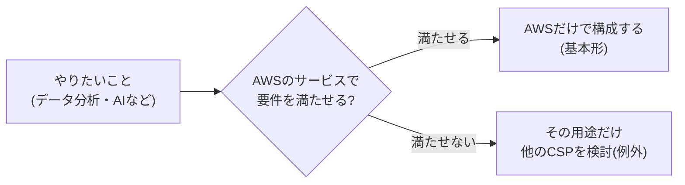

# 6. マルチクラウドは原則禁止 — 段階2: 原文を読み解く

出典: [GCASガイド ガバメントクラウド概要解説「6.6.1 マルチクラウド構成の基本方針」「6.6.2 マルチクラウドを許容するケース」](https://guide.gcas.cloud.go.jp/general)
英訳は筆者の訳(公式の英訳ではない)。カタカナの `/` は息継ぎ。ルールは [linking-rules.md](../../../linking-rules.md)。
「ガイド:」はGCASガイドに書かれていること、「推論:」は筆者の推論。

## 原文を1文ずつ読む

### 6.6.1 基本方針

| # | 原文 | English(筆者訳) | ポイント |
|---|---|---|---|
| 1 | 可用性や冗長性の確保を目的とした1つのシステムで複数のCSPを利用するマルチクラウド構成は、コスト増加や運用の複雑化を招くため推奨しない。 | A multi-cloud configuration that uses multiple CSPs in a single system to ensure availability and redundancy is not recommended, because it leads to higher costs and more complex operations. | 対象は「1つのシステム」の中。目的は「可用性や冗長性」。`lead to ...`(〜を招く) |
| 2 | 真に必要な場合を除き、原則禁止とする。 | Except where truly necessary, it is prohibited in principle. | `except where ...`(〜の場合を除き)、`in principle`(原則) |

### 6.6.2 許容するケース

| # | 原文 | English(筆者訳) | ポイント |
|---|---|---|---|
| 3 | 一つのシステム内でも、特定用途においては異なるCSPの利用も一部想定される。 | Even within a single system, using a different CSP is partly anticipated for specific purposes. | `even within ...`(〜の中でも)、`anticipated`(想定される) |
| 4 | 例としては、データ分析やAIサービスの利用時に主たるCSP環境のサービスで要件を満たせない場合等が挙げられる。 | One example is when the services in the main CSP environment cannot meet the requirements for data analysis or AI services. | `meet the requirements`(要件を満たす) |
| 5 | また、システムの一部としてのSaaSの活用は積極的に検討すること。 | Also, actively consider using SaaS as part of the system. | `actively consider ...`(積極的に検討する) |
| 6 | なお、異なるシステム間の連携において、データ連携や業務要件により、複数のCSPを利用することは問題ないものとする。 | Note that using multiple CSPs across different systems, because of data integration or business requirements, is not a problem. | `across different systems`(システム間で) |

## 読み解きのポイント

- ガイド: 範囲は「1つのシステム」の中。システムが別々なら、複数のCSPを使っても問題ない(文6)。
- ガイド: 禁止の対象になっている目的は「可用性や冗長性の確保」(文1)。
- ガイド: 「推奨しない」(文1)のあとに「原則禁止」(文2)と続く。二段構えで、「真に必要な場合」だけが例外。
- ガイド: 理由は「コスト増加」と「運用の複雑化」の2つ。
- ガイド: 許容される例は、データ分析やAIサービスで主たるCSPでは要件を満たせない場合。具体的なサービス名はガイドに書かれていない(→ 下の「具体例で考える」)。
- 学習ノートの段階1は `generally not recommended`(原則すすめない)。原文は「原則禁止」までいっているので、段階2で補った。
- 推論: 「1つのシステム内」と「システム間」で扱いが違うのは、複数のCSPにまたがる運用の複雑さが、1つのシステムの中で最も大きくなるからだと考えられる。ガイドにはこの説明はない。

## 具体例で考える(AWSが主たるCSPの場合)

ガイド: 許容される例として書かれているのは「データ分析やAIサービス」だけで、使ってよい他CSPの具体的なサービス名は書かれていない。
次の表は、ガイドに出てくるサービス名を使って、考え方を具体的にしたもの。「想定」は筆者の例で、実際に許容されるかはガイドからは判断できない。

| 用途 | まずAWSで検討する(ガイドに出るサービス) | AWSで満たせないときだけ、他CSPを検討(想定) |
|---|---|---|
| データ分析 | AWS Glue(事前処理)→ Amazon Redshift → Amazon QuickSight(ガイドのリファレンスアーキテクチャの統計処理の例) | 想定: Google Cloud の BigQuery(ガイドのGoogle Cloud版の統計処理の例に出てくる) |
| 生成AI・AI | Amazon Bedrock(デジタル庁が許可したモデルのみ。許可していないモデルの利用は禁止) | 想定: 他CSPのAIサービス |

- ガイド: 生成AIは、ガバメントクラウドで使えるのは「国内リージョンで完結可能なモデルに限定」される。
- 推論: 他CSPを使うと、1つのシステムの中で、運用(認証、監視、コスト管理)が2つのCSPにまたがる。文1が挙げる「コスト増加」「運用の複雑化」はここで起きる。だから「AWSで満たせないときだけ」になる。

### ガイドに出てくる、AWSと他CSPをつなぐ仕組み

| 仕組み | 内容(ガイドの記述) |
|---|---|
| GCAS Connect(GCASマルチクラウドネットワーク) | ガバメントクラウドの異なるCSP間のプライベート接続(P2P接続)を提供する。接続には各CSPの閉域接続サービス(AWS Direct Connect等)を使う。 |
| マルチクラウド間の認証 | クラウド1の一時トークンを、クラウド2の連携用の仕組みでクラウド2用の一時トークンに交換して使う(認証パターンの2-3)。 |
| AWS Distro for OpenTelemetry | 「マルチクラウドでありAWSとそれ以外のクラウドプロバイダーのトレースデータを一元管理したい場合」の有力な候補。 |

ガイド: GCAS Connect は「異なるCSP間をつなぐ」ためのネットワークサービス。
推論: 接続の仕組みがあることと、1つのシステム内のマルチクラウドが許容されることは別の話。許容の判断は文1・文2・文3のとおり。

## 5文で言ってみる

### 1 (文2)
- **日本語訳**: 1つのシステムでマルチクラウドにするのは、原則禁止。
- **English**: Multi-cloud in one system is prohibited in principle.
- **カタカナ**: マルティクラウドインワンシステム / イズプロヒビティディンプリンスィプル

### 2 (文1の理由)
- **日本語訳**: コストが増え、運用が複雑になる。
- **English**: It increases costs and makes operations complex.
- **カタカナ**: イリンクリースィズコスツ / アンメイクスアペレイションズコンプレクス

### 3 (文2の例外)
- **日本語訳**: 本当に必要な場合だけ使う。
- **English**: Use it only where truly necessary.
- **カタカナ**: ユーズィロウンリ / ウェアトゥルーリネセセリ

### 4 (文4)
- **日本語訳**: データ分析やAIでは、別のCSPが必要になることがある。
- **English**: Data analysis or AI may need another CSP.
- **カタカナ**: デイタアナリスィスオアエイアイ / メイニードアナザーシーエスピー

### 5 (文6)
- **日本語訳**: 別々のシステムなら、別々のCSPを使ってもよい。
- **English**: Different systems may use different CSPs.
- **カタカナ**: ディファレントシステムズ / メイユーズディファレントシーエスピーズ

## 語彙

| English | カタカナ | 日本語 | 詳しい説明 |
|---|---|---|---|
| multi-cloud | マルティクラウド | マルチクラウド | 複数のCSPを組み合わせて使う構成 |
| availability | アヴェイラビリティ | 可用性 | 必要なときにシステムが使える状態であること |
| redundancy | リダンダンスィ | 冗長性 | 障害に備えて、予備を持たせておくこと |
| complexity | コンプレクスィティ | 複雑化 | 仕組みが入り組んで、管理が難しくなること |
| prohibit | プロヒビット | 禁止する | してはいけないと決めること |
| in principle | インプリンスィプル | 原則 | 例外を除いて、基本的にはそうする、ということ |

[← マルチクラウドは原則禁止へ戻る](../README.md)
