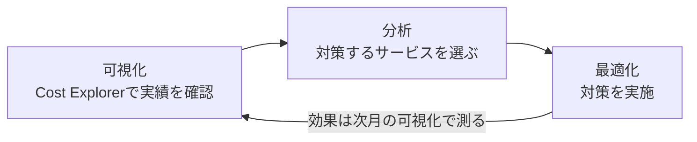

# 8. 継続的な見直しとコスト管理 — 段階4: AWSではどう実現するか

出典: [GCASガイド AWS技術ガイド「クラウド利用料の予実管理と最適化」](https://guide.gcas.cloud.go.jp/aws) / ガバメントクラウド概要解説 5.5
カタカナの `/` は息継ぎ。ルールは [linking-rules.md](../../../linking-rules.md)。

## 核心(原文)

> 恒常的に適切なサイジングとなっているかを見直し、必要であれば適切なサイズや数に変更を行う。また、常に稼働する必要のないものは必要なときだけ起動する等の改善も行う。

> 月次で「可視化」「分析」「コストの最適化」の順に実施する。

## 2つの仕事: 予実管理 と コストの最適化

| 仕事 | 目的 | 使うAWSサービス |
|---|---|---|
| 予実管理 | 予算を決め、実績を確認する | AWS Budgets |
| コストの最適化 | 運用の状況を見て、コストを継続的に改善する | Cost Explorer、Cost Anomaly Detection、Compute Optimizer など |

## 図で見る: 月次サイクル

## 予実管理のやり方(AWS Budgets)

1. デジタル庁から連携された**年度予算(USD)**を、利用月数で割って**月次予算**にする(例: 7月に払い出されたら翌年3月まで9か月なので、予算を9で割る)
2. アカウントが複数あるときは、アカウントごとに予算を設定する
3. 予算超過や、年額予算の超過見込みを知らせる**アラート**を設定する(しきい値は利用システムが決める)
4. 月次でAWS Budgetsの「月次コスト履歴」の「実際」を確認する(実績の確定は翌月3〜7日なので、**翌月7日以降**に見る)

## 分析の3つの観点

| 観点 | 見ること | 基準 |
|---|---|---|
| 費用分析 | サービス別の費用割合 | 上位3位のサービス |
| 異常値分析 | 直近3か月平均との比較 | 平均より**10%以上**超過したサービス |
| 傾向分析 | 6か月前との比較 | **30%以上**増加したサービス(毎月5%ずつの漸増を想定) |

異常値をすぐ知りたいときは Cost Anomaly Detection。コストの分析はUSDで行い、為替変動は考慮しない。

## 5文で言ってみる

### 1 (継続的な見直し)
- **日本語訳**: アーキテクチャとコストを、毎月見直す。
- **English**: Review your architecture and costs every month.
- **カタカナ**: リヴューヨアアーキテクチャアンコスツ / エヴリマンス
- **なぜ?**: クラウドの利用料は毎月変わる。だから、サイズが今も適切かを恒常的に見直す必要がある。予算より実績が下回っていても、月次で行うことが推奨されている。目的が、変化する運用状況に合わせて継続的に改善することだから。

### 2 (予実管理)
- **日本語訳**: 月ごとの予算をAWS Budgetsに設定して、実績を確認する。
- **English**: Set a monthly budget in AWS Budgets and check the actuals.
- **カタカナ**: セタマンスリバジェット / インエイダブリューエスバジェッツ / アンチェックジアクチュアルズ

### 3 (月次サイクル)
- **日本語訳**: Cost Explorerで見える化し、分析し、最適化する。
- **English**: Visualize with Cost Explorer, analyze, then optimize.
- **カタカナ**: ヴィジュアライズウィズコストイクスプローラー / アナライズ / ゼナプティマイズ

### 4 (異常値分析)
- **日本語訳**: 3か月平均より10%以上高いサービスを見つける。
- **English**: Find services that cost ten percent more than the three-month average.
- **カタカナ**: ファインドサーヴィスィズ / ザッコステンパーセントモア / ザンザスリーマンスアヴェリッジ

### 5 (必要なときだけ起動)
- **日本語訳**: 必要なときだけ、リソースを起動する。
- **English**: Start resources only when you need them.
- **カタカナ**: スタートリソースィズオンリ / ウェンニューニードゼム
- **例(原文の最適化対応)**: 検証環境のインスタンスを24時間365日動かさず、停止運用やスケジューラを使う。

> 補足(注意): 月末の分析は、サービス別費用が実際より少なく見えることがある。必要なら翌月初に分析する。報告用の資料は別に作らず、**ダッシュボード化**を推奨(管理工数の削減とリアルタイム性のため)。

## コスト配分タグ(見える化の道具)

| タグ | 使う場面 |
|---|---|
| Name | 基本的に全リソース。単独のリソースの料金を見る |
| SystemName | 1アカウントに複数システムがあるとき |
| Environment | 本番・ステージング・開発が同居するとき |
| Owner | 複数部門や事業者でアカウントを共用するとき |
| CostGroup1〜3 | 任意のグルーピングで集計したいとき |
| CostTag | 共同利用方式で自治体ごとに費用を按分するとき |

## AWSサービス名の読み

| English | カタカナ | 役割 |
|---|---|---|
| AWS Budgets | エイダブリューエスバジェッツ | 予算の設定と実績の確認、アラート |
| Cost Explorer | コストイクスプローラー | コストの可視化・分析 |
| Cost Anomaly Detection | コストアノマリーディテクション | コストの異常を検知 |
| Compute Optimizer | コンピュートオプティマイザー | EC2などの適切なサイズの提案 |
| Savings Plans | セイヴィングズプランズ | 利用量を約束して割引を受ける |
| QuickSight | クイックサイト | 分析ダッシュボード |

## 語彙

| English | カタカナ | 日本語 | 詳しい説明 |
|---|---|---|---|
| budget | バジェット | 予算 | 使ってよい金額の上限。年度予算を月ごとに割って管理する |
| actuals | アクチュアルズ | 実績 | 実際にかかった費用。確定は翌月3〜7日 |
| visualize | ヴィジュアライズ | 可視化 | グラフなどで、サービス別の推移や割合を見えるようにすること |
| anomaly | アナマリー | 異常値 | いつもと大きく違う費用。3か月平均より10%以上高い場合など |
| optimize | アプティマイズ | 最適化 | 性能を保ったまま、無駄なコストを減らすこと |
| rightsizing | ライトサイズィング | 適正なサイジング | 使用率に合わせて、サイズや台数を見直すこと |

[← 継続的な見直しとコスト管理へ戻る](../README.md)
