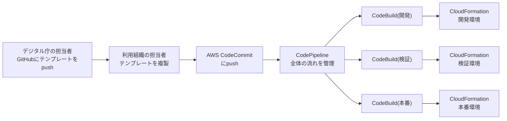
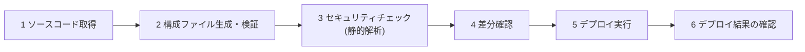

# 補章: IaC と CI/CD(デリバリーパイプライン)を読む

出典: [GCASガイド「デリバリーパイプライン構築(AWS編)」](https://guide.gcas.cloud.go.jp/aws) / [運用モダン化実践ガイド 第3章・別紙3-1「IaCツールとCI/CDパイプライン実装の検討ポイント」](https://guide.gcas.cloud.go.jp/modernization-guide)
英訳は筆者の訳。カタカナの `/` は息継ぎ(ルールは [linking-rules.md](../linking-rules.md))。
「ガイド:」はGCASガイドに書かれていること、「推論:」は筆者の推論、「ガイド外:」はガイドに書かれていない情報。

## 1. まず結論

- ガイド: IaCの活用は3つのレベルがある。**レベル3(CI/CDパイプラインによる自動デプロイ)が推奨**。新しいシステムは、最初からレベル3を目指す。
- ガイド: **レベル1(初期構築だけIaC、あとは手動変更)は、選択すべきでない**。
- ガイド: AWS編の「デリバリーパイプライン構築」が対象にするのは、**インフラ**のデリバリー。アプリのCI/CDは、システムの特性で構成が大きく変わるので、利用組織が最適化して検討する。
- ガイド: 「パイプラインIaCファイルの利用方法」は、「詳細な仕様が決まり次第、執筆予定」(読んだ時点で未記載)。

## 2. AWSのデリバリーパイプライン(AWS編)

- ガイド: 各コンポーネントは「例」。ガバメントクラウドが提供する予定のパイプラインIaCファイルが出るまでは、利用組織がパイプラインを設計する。
- ガイド: パイプラインのツールに特段の制限はないが、**特定のベンダーしか使えないツールは、ベンダーロックインのリスクがあるので控える**。
- ガイド外: 図に出てくる **AWS CodeCommit は、2024年6月6日から新規のお客様の受付を停止している**とされる([Simon Willison のまとめ](https://simonwillison.net/2024/Jul/30/aws-codecommit-quietly-deprecated/))。ガイドの図が現在の状況に合っているかは、要確認。
- ガイド: 開発環境が必要な利用システム(CI/CDを実施するもの)には、開発環境が提供される。インフラ部分は、ガバメントクラウドが指定するツールやテンプレート/IaCファイルでCI/CD環境を構成する。ほかを選ぶ場合は、合理性が認められる場合のみ(AWS技術ガイドの「アカウント構成説明」より)。

## 3. IaCの3つのレベル(運用モダン化実践ガイド 3.3.5)

| レベル | 内容 | ガイドの評価 |
|---|---|---|
| 1 | 初期構築だけIaC。あとの変更は手動 | **選択すべきでない**。変更がIaCに反映されず、IaCコードと実環境がずれて、設計書としての価値を失う。手動変更の人的ミスも残る |
| 2 | 全変更をIaCで管理。デプロイは手動 | 段階的な導入の現実的な一歩。ただし、手動デプロイの入力ミス、環境の取り違え、デプロイ担当者に変更権限が必要、という課題が残る |
| 3 | CI/CDパイプラインで自動デプロイ | **推奨**。人的ミスの排除、変更権限の付与が不要、いつ誰が何を変えたかの記録(監査性)の3つの利点 |

## 4. IaCの進め方

### ツールの選び方(別紙3-1)

- ガイド: **CSPが推奨するツールを優先**して検討する。AWSなら AWS Cloud Development Kit(AWS CDK)。新サービスへの迅速な対応、バグや脆弱性の修正が早い、CSPサポートの技術支援が手厚い、という利点がある。
- ガイド: ただし、チームが特定のツールに習熟している、特定のツールにしかない機能を重視する、という場合は、別のツール(例: Terraform)も候補にする。

### リソースの分割方針(優先順位つきの3観点)

| 順位 | 観点 | 例 |
|---|---|---|
| 1 | 管理担当者 | インフラチームの基盤リソース / アプリチームのアプリ固有リソース |
| 2 | 機能・サービス | ネットワーク、セキュリティ、データなど |
| 3 | ライフサイクル(更新頻度) | 低頻度(ネットワーク、アクセス制御) / 高頻度(アプリ) |

### IaCで管理する範囲(3.3.3)

- ガイド: **使うリソースの全部をIaCで管理するのが原則**。部分的なIaCだと、手作業を排除できず、人的ミスが残る。変更頻度が低くても同じ。
- ガイド: 例外は、IaCツールが対応していないサービス、SaaSなど他のサービスとの連携設定、複数サービスにまたがる設定。無理にIaCにすると、属人化して技術負債になる。その場合は、CLIでのスクリプト化。それも難しければ、事前に手順書を用意して手動作業。
- ガイド: 手動作業をするなら、画面操作(GUI)より**コマンド操作(CLI)**が望ましい。画面は変更されると手順書どおりに操作できず、ボタンの誤認などのミスも起きやすい。

### IaCのハマりどころ(3.3.3)

- ガイド: DBやストレージなど、**ステートフルなリソースは、削除防止(保持設定)を検討する**。IaCコードの変更が、どのリソースの削除につながるか、直感的にわからないことがある。
- ガイド: マネージドサービスの**自動パッチ適用**で、IaCコードのバージョンと実際の状態にずれが出る。放置すると、次のデプロイで意図しない再作成や設定変更が起き、停止やデータ損失のリスクがある。対処: ①ツールのドキュメントで変更の影響を確認 → ②検証環境でデプロイのテスト → ③本番に適用。

### コードレビューとコーディング規約(3.3.4)

- ガイド: レビューは2つ。**ツールによる自動レビュー**(静的解析: ストレージの公開、緩すぎるFW、命名規則違反、必須パラメータの欠落など)と、**人によるレビュー**(要件との整合、設計方針との矛盾、保守のしやすさ、コストへの影響)。
- ガイド: プルリクエスト作成時にパイプラインで静的解析を動かし、問題がないときだけマージを許可する運用にすると、レビュアーは人の判断が必要な観点に集中できる。
- ガイド: アプリ開発と同様に、コーディング規約を決める。機械でチェックできる項目は自動化し、目視の項目はチェックリストにする。

## 5. パイプラインの作り方(別紙3-1)

### 自動化する手順(表2)

- ガイド: セキュリティチェックで、リソースの意図しない公開などを、デプロイ前に検出できる。パイプラインでやると、実装者のローカル環境の状況に関わらず、すべてのデプロイに一貫して実行できる。
- ガイド: 結果の確認の例は、パイプライン内でAPIエンドポイントを呼び出して、接続とアプリの動作を確認すること。

### ツールの選び方

- ガイド: **CSPのマネージドサービスや、Gitサービスの付随機能を優先**する(実行環境の管理やログ管理が自動化されている)。
- ガイド: **仮想サーバー上にパイプライン用のミドルウェアを自作する方式は、避けるべき**。管理・保守・セキュリティの運用負荷がかかる。パイプラインの障害はリリースに影響するので、可用性の面でも、マネージドを優先する。

### アプリとインフラの管理

| 項目 | ガイドの方針 |
|---|---|
| パイプライン | 基本は**アプリとインフラを分離**する(更新頻度と変更の性質が違う)。クラウドリソースの操作はインフラ側に集約し、アプリ側は、デプロイに必要な最小限の操作だけ |
| 連携 | インフラ側がリソース名やエンドポイントを、設定管理サービスやIaCの出力機能で、アプリ側に渡す |
| リポジトリ(チームが分かれている) | 分ける(責任範囲が明確になり、並行作業しやすい) |
| リポジトリ(チームが1つ) | 統合も選べる。ただし、**統合しても、パイプラインは分ける**ことを推奨(ファイルの更新に応じた実行の切り替えができないツールがあるため) |
| パイプライン統合のメリット・デメリット | 小規模なら管理が楽。ただし、アプリ更新のたびにインフラ確認が走り、インフラの問題がアプリのデプロイに波及し、アプリだけのロールバックが難しくなる場合がある |

### ブランチ戦略(IaCの場合)

- ガイド: IaCは、機能単位のリリースではなく、**環境(開発 → 検証 → 本番)単位で段階的に適用**する。変更は、必ず下流から上流へ一方向に進む。そのため、**環境ごとにブランチを用意する方式が適していることが多い**。

| 方式 | ブランチ | 流れ |
|---|---|---|
| GitLabフロー | `develop`(開発環境)、`staging`(検証環境)、`production`(本番環境) | `feature` ブランチで作業 → プルリクエスト → `develop` にマージで開発環境へ自動デプロイ → `staging` にマージで検証環境へ → `production` にマージで本番環境へ |
| GitHubフロー | `main` のみ(常にデプロイ可能) | `feature` ブランチ → プルリクエスト → `main` にマージ後、リリース発行か手動起動で、開発 → 検証 → 本番へデプロイ |

- ガイド: `develop` や `main` への**直接コミットは禁止**。すべての変更はプルリクエストを経由する。

### 手動から自動へ(レベル2からレベル3へ)

ガバメントクラウドでは、本番、検証、開発の環境を払い出せるので、安全に段階を踏める。前提は、各環境にIaCコードが手動でデプロイ済みで、コードと環境の状態が一致していて、パイプラインの定義自体もIaCで管理していること。

| ステップ | 内容 |
|---|---|
| 1 | 開発環境で、コード取得からセキュリティチェックまでのパイプラインを作る(デプロイはしない) |
| 2 | 差分確認を追加し、現在の環境との差分がないことを確認する |
| 3 | デプロイ機能を追加する(差分がないので、リソースは変わらず、安全に動作確認できる) |
| 4 | 検証済みのパイプラインを検証環境に適用して、同様に確認する |
| 5 | 本番環境に適用して、同様に確認する |

- ガイド: 安定稼働を十分に確認してから、手動デプロイ用の**担当者の権限を削除**する(緊急時用の権限は別途検討)。これで、すべての変更がパイプラインを通ることを保証できる。

## 6. Zero Touch Production と、緊急時のログイン

- ガイド: 本番のサーバログインや、管理コンソールでの設定変更を、自動化で不要にする(Zero Touch Production)。人的ミスと不正操作の影響を最小限にできる。検証環境でも同様に実現する。
- ガイド: 定型作業は、スクリプト化して、サーバレス実行環境やタスクスケジューリングで自動化する。**踏み台サーバの運用が不要になる**。
- ガイド: 自動化は、なんでも最適とは限らない。技術的に難しい、頻度が極めて低い、一時的・試験的な作業は、手動でもよい。ただし、**人的ミスの影響が重大な作業は、頻度が低くても、自動化を優先して検討する**。
- ガイド: 手動作業が出たら、日時、内容、手動が必要だった理由、今後自動化できるか、を記録して、自動化の範囲を広げる。

### 緊急時のログイン(3.2.3)

- ガイド: 重大な障害やセキュリティインシデントでは、例外的に手動の設定変更が必要になることがある。緊急時専用の権限を用意して、**終わったら速やかに削除**する。
- ガイド: 権限は2段階にする。**参照権限**(状況確認用。通常はこちら)と、**管理者権限**(復旧作業用。更新作業時のみ昇格)。
- ガイド: 管理者権限を使うときは、**単独作業をせず、確認者をつけて相互確認**し、事前に手順を確認してから実施する。操作履歴(実行者、内容、時刻)をすべて記録する。
- ガイド: 昇格は、担当者のリクエストを**承認者が承認**する。承認体制は、夜間・休日も機能させる(不在時のエスカレーション手順も決める)。昇格は、管理者に通知する。承認のない不正な昇格は、権限を無効化して、根本原因を分析する。
- ガイド: 事前に、権限の作成、承認プロセスの整備、定期的なテストをしておく。

## 7. アプリのデプロイ戦略(3.4)

| 戦略 | 流れ | システム停止 | 実装の難易度 | ロールバックの難易度 |
|---|---|---|---|---|
| In-Place | 旧版を止めて、同じ環境に新版を入れる | あり | 低 | **高** |
| ローリング | 1台ずつ順に入れ替える | なし | 中 | 中 |
| Blue/Green | 新環境(Green)を用意して、トラフィックを切り替える | なし | **高** | 低 |
| カナリア | 一部(例: 10%)から新版に振り分け、段階的に増やす | なし | **高** | 中 |

| 戦略 | 主なデメリット(ガイド) |
|---|---|
| In-Place | 停止が避けられない。全サーバに同時に入れるので、バグの影響が全体に及ぶ。戻すには再デプロイやリストアが必要 |
| ローリング | 更新中は処理能力が一時的に落ちる。新旧が同時稼働するので、互換性が必要。どのインスタンスがどの版か、把握が必要 |
| Blue/Green | 新旧の環境を同時に持つので、追加コストがかかる。DBのスキーマを変えると、データの同期が複雑 |
| カナリア | 追加コスト、トラフィック制御の仕組み、バージョン別の詳細な監視が必要。複数のバージョンの長期並行運用 |

- ガイド: ダウンタイムと実装の難しさのバランスで選ぶ。システムの進化に応じて、より高度な戦略への移行も推奨される。
- ガイド: **ロールバックの方法は、デプロイ戦略とあわせて選ぶ**。Blue/Greenなら、ルーティングを旧環境に戻して、数秒から数分で完了する。カナリアなら、新版への割合を0%に戻す。
- ガイド: ロールバックの3要素は、監視、判断、実行。**自動化を優先するのは、監視と実行**。実行するかの判断は、状況の重大性を見て、担当者の確認をつけることが望ましい(意図しない自動ロールバックを防ぐため)。監視には、応答時間の悪化や、APIのエラー率の上昇など、利用者に影響が出やすいメトリクスを使う。
- ガイド: 新環境が安定稼働するまで、旧環境や、コンテナイメージ、設定ファイルなどの成果物を、保管しておく。
- ガイド(モダン化の定義): 無停止でリリースできるデプロイ戦略は、コスト増になる場合がある。サービスレベルの範囲で、停止を許容する判断も必要(「アプリの作り方」の補章のとおり)。

## 8. 「やったほうがいい / やめとけ」のまとめ

| やったほうがいい | やめとけ |
|---|---|
| IaCのレベル3(CI/CDで自動デプロイ)。新システムは最初から | レベル1(初期構築だけIaC)。コードと実環境がずれる |
| CSP推奨のIaCツール(AWSならCDK)を優先して検討 | 特定ベンダーしか使えないツール(ロックイン) |
| 全リソースをIaCで管理 | 部分的なIaC。手作業が混ざって複雑になる |
| 手作業が必要なら、CLIのスクリプトか手順書 | GUIでの手動操作(画面変更や誤クリックのリスク) |
| ステートフルなリソースに、削除防止の設定 | IaCの変更で、DBやストレージが消えることに気づかない |
| パイプラインに、静的解析と差分確認を入れる | ローカルの確認だけに頼る |
| パイプラインは、マネージドサービスやGit付随機能で | 仮想サーバー上にパイプライン用ミドルウェアを自作 |
| アプリとインフラで、パイプラインを分離 | 統合したまま、アプリ更新のたびにインフラ確認を走らせる |
| 環境ごとのブランチ(または`main`+段階的デプロイ)、プルリクエスト経由 | `develop` や `main` への直接コミット |
| 本番ログインなし。緊急時だけ、2名以上・承認つきで昇格 | 常時、管理者権限で本番に入る。昇格した権限の削除忘れ |
| ロールバックの監視と実行を自動化。判断は担当者が確認 | 判断まで完全に自動化して、意図しないロールバックを起こす |
| 人的ミスの影響が大きい作業は、低頻度でも自動化を検討 | 低頻度・一時的な作業まで、過剰に自動化(オーバーエンジニアリング) |

## 9. ガイドが書いていないこと

- パイプラインIaCファイルの詳しい仕様(「決まり次第執筆予定」)。
- AWS CDK の書き方や、CodePipeline・CodeBuild の具体的な設定値。
- 各デプロイ戦略を、AWSのどのサービスで実現するか(このガイドの読んだ範囲では、サービス名の対応は書かれていない)。
- アプリのCI/CDの具体的な構成(利用組織が検討する)。

## 10. 5文で言ってみる

### 1
- **日本語訳**: 全部の変更を、IaCで管理して、パイプラインで自動デプロイする。
- **English**: Manage every change as code and deploy it by pipeline.
- **カタカナ**: マニジェヴリチェインジアズコウド / アンディプロイイットバイパイプライン

### 2
- **日本語訳**: 初期構築だけにIaCを使うのは、やめる。
- **English**: Don't use IaC only for the initial build.
- **カタカナ**: ドウントユーズアイエイシーオウンリフォジイニシャルビルド

### 3
- **日本語訳**: 本番環境への変更は、必ずパイプラインを通す。
- **English**: Every change to production goes through the pipeline.
- **カタカナ**: エヴリチェインジトゥプロダクション / ゴウズスルーザパイプライン

### 4
- **日本語訳**: 緊急のときだけ、承認を得て、権限を上げる。
- **English**: Raise privileges only in an emergency, with approval.
- **カタカナ**: レイズプリヴィリッジズ / オウンリインアニマージェンスィ / ウィズアプルーヴァル

### 5
- **日本語訳**: 問題が起きたら、旧環境に切り戻す。
- **English**: If something goes wrong, switch back to the old environment.
- **カタカナ**: イフサムスィングゴウズロング / スウィッチバックトゥジオウルドインヴァイロンメント

## 語彙

| English | カタカナ | 日本語 | 詳しい説明 |
|---|---|---|---|
| CI/CD (continuous integration / continuous delivery) | スィーアイスィーディー | CI/CD | コードの変更を、自動でテストして、自動で配置し続ける仕組み |
| pipeline | パイプライン | パイプライン | 取得、検証、デプロイなどの手順を、順に自動で流す仕組み |
| static analysis | スタティックアナリスィス | 静的解析 | 実行せずに、コードを読んで、問題のある設定を見つけること |
| pull request | プルリクエスト | プルリクエスト | 変更を取り込んでほしいという依頼。レビューを受けてから統合する |
| branch | ブランチ | ブランチ | 本流から枝分かれして、独立して作業できる、Gitの仕組み |
| rollback | ロールバック | ロールバック | 変更前の状態に戻すこと |
| canary release | カナリアリリース | カナリアデプロイ | 一部の利用者にだけ新版を出して、様子を見ながら広げる方式 |
| vendor lock-in | ヴェンダーロックイン | ベンダーロックイン | 特定の事業者の製品に依存して、乗り換えにくくなること |
| privilege escalation | プリヴィリッジエスカレイション | 権限昇格 | 一時的に、より強い権限を得ること |
| drift | ドリフト | ずれ | IaCのコードと、実際の環境の状態が一致しなくなること |

[← 大括りへ戻る](../overview.md)
