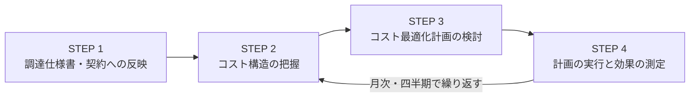

# 補章: コスト最適化アプローチと FinOps を読む

出典: GCASガイド[「コスト最適化アプローチガイド」(第2〜5章)](https://guide.gcas.cloud.go.jp/modernization-guide)と[「継続的運用経費最適化(FinOps)ガイド」(第2〜4章)](https://guide.gcas.cloud.go.jp/modernization-guide)。FinOpsガイドの第5〜6章(運用管理補助委託料、地方公共団体の留意事項)と別紙は、全部は読んでいない。
英訳は筆者の訳。カタカナの `/` は息継ぎ(ルールは [linking-rules.md](../linking-rules.md))。
「ガイド:」はGCASガイドに書かれていること、「推論:」は筆者の推論。
**注意**: ガイドの削減額は、サンプルの**試算**(令和6年8月時点のAWSの仕様・料金、1ドル=150円、年額)。「必ずしも記載する削減率が達成されるとは限らない」とガイドが断っている。

## 1. 前提: オンプレミスとクラウドで、コストの考え方が違う

- ガイド: **ガバメントクラウドへの単純移行では、費用削減に限界がある**。効率的な運用で、ランニングコストを最適化する。

| | ガバメントクラウド | オンプレミス |
|---|---|---|
| コスト構造 | 利用した時間分だけ課金。不要なリソースは停止・削除すれば課金も止まる。**継続的にコスト削減に取り組むことが肝要** | 初年度の機器導入費と、毎年の保守費が固定。不要になった機器も保有し続ける |
| リソースの確保 | 必要なときに初期費用なしで即座に使える。需要に応じて拡張・縮小できるので、**緻密なサイジングが不要** | 緻密なサイジング、調達、搬入で数か月かかる。実需以上のリソースを保険的に確保して、余剰が出る |
| 構築・検証 | IaCで、何度でも同じ構成を即座に構築。マネージドサービスはAPI仕様とサービスレベルが定義されていて、インフラの統合テストが不要 | 現地での構築作業。環境依存で検証工数がかさむ |
| 運用 | マネージドサービスで、物理機器・OS・ミドルウェアの運用から解放。少人数で運用 | すべて自前で運用保守。人的な運用コストがかさむ |
| データの可視化 | コストデータなどがCSPの機能で標準提供され、すぐにコスト削減に着手できる | 専用ソフトの導入が要る。コスト構造が硬直的で、無駄が見えても下げにくい |

### 経費の内訳(ガバメントクラウド先行事業の例)

| 経費項目 | 割合の例 |
|---|---|
| システム運用作業 | 25.06% |
| ソフトウェア借料 | 24.75% |
| **クラウド利用経費** | 23.59% |
| ソフトウェア保守費 | 11.14% |
| 通信回線費 | 8.56% |
| その他(ハードウェア、データセンター、外部委託など) | 約6.9% |

- ガイド: このガイドは、**最も削減しやすく、効果が高く、他の項目に波及しやすい「クラウド利用経費」に着目**する。ランニングコスト全体の約1/4を占める。
- ガイド: クラウド利用経費は、**サーバーとデータベースで約9割**を占める傾向がある(コスト最適化アプローチガイド)。FinOpsガイドでは「仮想サーバーとデータベースで8割」と書かれている。どちらも「大きな割合を占める」という意味。経費割合が高いサービスから見直す。

## 2. コスト最適化の9つのアプローチ(クラウド利用経費)

優先度は、実施難易度とコスト削減効果で、A〜C。**優先度の高い順に実施**する。

| # | アプローチ | 優先度 | 要点(ガイド) |
|---|---|---|---|
| 1 | インスタンスサイズの選定 | A | 最初から安全マージンを含めた過剰なサイズで見積もらない。**通常時の使用量**で選び、必要なら大きくする |
| 2 | インスタンスタイプの選定 | A | 用途に合うタイプを選ぶ。**最新世代**は、同じvCPUやメモリでも高性能で低価格な傾向 |
| 3 | 稼働時間の調整 | A | 夜間や週末など、使わない時間は停止する |
| 4 | ストレージ選定・容量の変更 | A | 最低限の容量から始めて、年次または隔年で拡張する |
| 5 | 運用のマネージドサービス化 | A | バックアップ・監視・ログ・セキュリティを、マネージドで |
| 6 | DR構成の選定 | A | 要件を見直して、過剰なDR構成を避ける |
| 7 | ストレージクラス選定とライフサイクル管理 | B | 古いデータを安価なクラスへ移し、期間が過ぎたら自動削除 |
| 8 | 柔軟なリソース確保 | B | オートスケールで、遊休リソースを減らす |
| 9 | 不要なログの削減 | C | 出力レベルや保存期間を見直し、マネージドサービスに保存 |

- ガイド: すでに稼働しているシステムには、各アプローチの前に、CSPのアセスメントサービスの活用を推奨する。
- ガイド: ネットワーク通信料金は、クラウド利用経費全体に占める割合が大きくないので、削減アプローチの対象にしない。

### 各アプローチのポイントと、試算例(AWS)

**1. インスタンスサイズ**
- ガイド: **5年先の使用量予測や、ピーク時に合わせたサイジングは不要**。通常時の使用量(現行環境のCPU使用率など)でサイジングして、需要に応じて変更する。変更は再起動を伴うだけ。変更を自動化するか、手動拡張の運用プロセスを事前に整える。
- 試算例: DBサーバー(RDS 2台)。ピーク(年度末の2か月)は通常時の2倍必要。**通常時もピーク時のサイズ**(16vCPU/64GB)から、通常時は半分(8vCPU/32GB)、ピーク時だけ元のサイズに。**519万円 → 302万円(42%削減)**。

**2. インスタンスタイプ**
- ガイド: タイプは、汎用、バースト可能、コンピューティング最適化、ストレージ最適化、メモリ最適化。一時的に負荷が上がるシステムや、性能が厳密に求められない開発・検証環境は、安価な**バースト可能**が有効。ただし、安定した性能を提供しないので、**事前に十分な検証**をする。
- ガイド: 最新世代にする前に、アプリとの互換性、セキュリティパッチを確認する。**CPUアーキテクチャが変わるときは、検証環境で互換性を中心に検証**する。

**3. 稼働時間**

| 稼働 | 週の稼働時間 | 削減率 |
|---|---|---|
| 停止なし | 168時間 | - |
| 土日停止 | 120時間 | 29% |
| 土日と平日夜間(22:00-6:00)停止 | 80時間 | 52% |

- ガイド: 夜間の定期処理を業務時間内で実行する、依存関係を確認して定期処理を並列で実行する、などの見直しも検討。停止対象は、検証・CI/CD・開発環境など業務影響が少ない環境。本番では、利用頻度の低い踏み台サーバーや夜間バッチ用サーバーなど。自動化は **AWS Instance Scheduler** などを検討。
- ガイド: 停止運用ができず稼働時間が長いなら、損益分岐点を考慮して**長期継続割引(Savings Plans等)**を検討。ガバメントクラウドには購入条件があり、詳細はメンバー専用ページ。
- ガイド: **クラウド側のキャパシティ不足で、起動できない場合がある**。業務上重要なサーバーを起動停止するなら、起動の自動化の仕組みで対策する。業務開始直前(7:00〜9:00)、月末月初、きりのよい時間(9:00など)は、起動リクエストを避けるのも有用。対策は、①数分待ってリトライ、②1回の起動台数を減らして分割(15台なら5台ずつ3回、または1台ずつ15回)、③同じスペックで何度も不足なら、vCPUやメモリを変えて再送、④複数のゾーンを指定するか、別のゾーンへ送る。
- 試算例: Web/APサーバー(EC2 2台、常時稼働227万円)を平日夜間と休日停止にして**28万円(87%削減)**。バッチサーバー(227万円)を夜間8時間のみにして**75万円(67%削減)**。踏み台サーバー(28万円)を月24時間のみにして**約9,331円(97%削減)**。

**4. ストレージ**
- ガイド: 数年後を見据えた大きな容量は不要。**1〜2年後に必要な容量の1.2〜1.5倍(利用率60〜80%)**をターゲットに、年次または隔年で拡張する。**RAIDのための容量やスペアディスクは不要**(可用性はCSP側で担保)。
- 試算例: EBS gp3 7.5TB(RAID、スペア、バックアップ込み)を、実容量の1.57TB+EBSスナップショットに。**129万円 → 22万円(83%削減)**。

**5. 運用のマネージドサービス化**
- ガイド: バックアップ、セキュリティ、監視、ロギングを、マネージドサービスで代替。**独自の運用管理システム(バックアップ、ジョブ管理など)の構築は避け**、可能な限りマネージドサービスに置き換える。マネージドで実現が難しい運用作業は、要件の見直しや、実現可能な運用への変更を検討する。

**6. DR構成**

| DR構成 | 概要 | コスト | 復旧時間 |
|---|---|---|---|
| バックアップ | 事前にバックアップを取り、障害時はそれをもとに復旧 | 低 | 長 |
| ウォームスタンバイ | 別地域に最小限の縮退環境を常時起動し、障害時に追加・切り替え | 中 | 中 |
| アクティブ/アクティブ | 別地域に本番と同等のスタンバイ環境を常時起動し、即座に切り替え | 高 | 短 |

- ガイド: IaCなどで環境を素早く構築できるので、スタンバイ環境の削減を検討できる。職員向けシステムや、停止しても即座に国民生活に影響がないものは、**バックアップ**を検討する想定。AWSでは、**AWS Backupのクロスリージョンバックアップ**で、システムデータ(AMI、プログラム、IaCコード)と業務データ(RDSスナップショット、ファイル)をS3に格納する構成を例示。
- ガイド: バックアップを採用しても、過剰な冗長化や、高頻度のフルバックアップになっていないかを確認する。例: 別のシステムが遠隔地に日次で副本を送っているデータは、インフラ側の遠隔地バックアップを削減する。

**7. ストレージクラスとライフサイクル**

| クラス | 特徴 | 向いているデータ |
|---|---|---|
| 標準 | 高耐久・高可用、低レイテンシー | アクセス頻度が高い |
| 低頻度 | 標準と同等のスペックだが高レイテンシー。取り出しごとに課金 | アクセス頻度が低い |
| アーカイブ | 最も低コスト。取り出しに数分〜数時間 | 長期アーカイブ |

- ガイド: バケット単位で、アクセス頻度に応じて格納先を分ける。ライフサイクルは、サードパーティ製品なしで、付随機能で自動化できる。

**8. 柔軟なリソース確保(オートスケール)**
- ガイド: 新しいインスタンスが作られ、既存が削除されるので、**データはDBやオブジェクトストレージ**に、**セッション情報は外部のストレージ**に。アプリが**ステートレス**か確認する。負荷の増減が不定期ならCPU・メモリ使用率でトリガー、定期的(月末のみなど)なら**スケジュールによるオートスケール**も可能。

**9. 不要なログの削減**
- ガイド: 例: 出力レベルを `FATAL, ERROR, WARN, INFO, DEBUG, TRACE` から `FATAL, ERROR, WARN, INFO` に、保存先を独自のログ管理システムからマネージドサービスに、保存期間を2年から1年に。保管が必要なデータは、ブロックストレージでなくオブジェクトストレージへ。不要な一時ファイルは定期的に削除し、データが単調増加する前提の過剰な見積もりはしない。

### 運用保守作業費・ソフトウェア借料

| 分類 | アプローチ | 優先度 | 概要 |
|---|---|---|---|
| 運用保守作業費 | 定量的計測の実現 | B | 従来のシステム監視から、**オブザーバビリティ**を高めて根本原因を迅速に特定するサービス監視へ。常駐人員の廃止や不要な監視工数を減らす |
| 運用保守作業費 | IaC・マネージドサービス活用による自動化 | B | 構築作業やメンテナンスの余剰な工数を抑える |
| ソフトウェア借料・保守費 | クラウド移行によるライセンスの見直し・削減 | C | 運用管理系のソフトウェアをマネージドサービスに置き換え、不要なソフトと数量を見直す |

## 3. FinOps(継続的に運用経費を最適化する)

### 4つのステップ

### 実践のポイント(ガイド)

| ポイント | 内容 |
|---|---|
| **本番稼働が、コスト最適化のスタート地点** | オンプレミスは、契約時に複数年度分の金額が決まる。クラウドは従量課金で、**実際の利用状況に基づくコスト**を把握・管理して、契約期間中にもすぐ最適化できる。稼働実績がない時点では、過不足を事前に把握できないので、稼働時点のシステムは余剰リソースや過剰なスペックを含む可能性が高く、運用開始後に最適化の余地がある |
| **コスト把握・最適化計画の主体は職員** | 従来は契約期間中、コストが固定だった。職員がFinOpsの主体として、事業者などに働きかける。事業者は、職員の求めに応じて、改善策の提案やシステム変更に取り組む。共同利用方式の地方公共団体は、運用管理補助者との協業が必要 |
| **成果を調達仕様書・契約に反映する** | 最適化された構成や運用保守作業を前提に調達する。複数年度の契約でも、**年度ごとに契約内容と金額を見直す**ことを前提にする。FinOpsで支出が減って、予算に余剰が生じることも考えられるが、**コストが最適化された結果として捉え、行政サービスの向上に資する取り組みへ充当**する |

### STEP 1: 調達仕様書・契約への反映

- ガイド: 事業者に求める要件の例。①クラウド利用実績の可視化(ダッシュボード、予算超過のアラート)、②**最適化提案**(CSPのレコメンデーションサービスも使う。提案や対応の件数・頻度をKPIにすることも検討)、③翌年度の改善提案と目標設定(最適化の目標値を契約年度に盛り込む)。運用管理補助委託料は、作業の明細を作り、作業ごとのコストや最適化余地を可視化する。
- ガイド: **コスト改善活動の契約は、別途契約を結ばず、運用保守契約の一部**として位置づける。定型的な運用作業(常時監視、障害の一次対応など)は、MSP(マネージドサービスプロバイダー)に委託すると、コストを最適化できる可能性がある。
- ガイド: 契約の見直し観点は、委託内容、契約期間(RFIで事業者の技術力とクラウド対応状況を把握)、クラウド利用料(毎年度、最適化目標値を協議)、運用管理補助委託料(作業を明細化し工数を明示。IaCやマネージドで自動化できる作業は、自動化の協議を要件に明記)。

### STEP 2: コスト構造の把握

- ガイド: クラウド利用料を**環境別**に可視化して、大きな割合を占める環境を優先して確認する(例: 本番の割合が高いなら、まず本番)。**仮想サーバーとデータベースで8割**を占めるのが一般的な構造。一般的な構造と比べて大きな割合のサービスがあれば、最適化の余地がある(例: データ通信費が多ければ、課金される通信の量と頻度を確認)。前年比・前月比で急増した環境・サービスは、増加要因(一時的な利用量の増加、設定変更、障害など)を特定する。
- ガイド: **モダン化していない構成は、仮想サーバーの利用量が多い**。仮想サーバー自体の利用料に加え、運用保守のコストもかかる。モダン化した構成は、仮想サーバーを減らして、マネージドサービスの利用量が相対的に高くなり、全体としてコストを最適化できる。構成を3段階で比較している(1. 仮想サーバーのみの旧来型、2. 業務系基盤・DB・管理系基盤をフルマネージドにしてアプリをコンテナ化した部分的モダン化、3. 管理系基盤をフルマネージドにし、業務系基盤とDBにサーバレスを使ったモダン化)。**段階的に3を目指す**。

| 可視化ツール | 概要 |
|---|---|
| クラウド管理画面 | CSPが提供。AWSはアカウントごと。リソース詳細やレコメンドサービスも使える。共同利用方式の地方公共団体では、職員への閲覧権限の付与は不可 |
| コスト最適化ダッシュボード(任意) | 可視化したいメトリクスに合わせて事業者に構築を依頼。「定量的計測の実装方法」とデジタル庁のサンプルIaCを参照 |
| 地方公共団体向けGCASコストダッシュボード | GCASから利用できる。請求書と連動し、月次請求のタイミングで反映。アカウント別・サービス別のコスト画面 |

### STEP 3: コスト最適化計画の検討

- ガイド: 職員は事業者と協働して、最適化できるリソースを特定し、**即効性のある変更を優先**する。
- ガイド: AWSの**レコメンデーションサービス**は、**AWS Cost Optimization Hub**(AWSのベストプラクティスに沿った推奨事項)と**AWS Compute Optimizer**(仮想マシンのサイズ適正化やDBの最適化の推奨をダッシュボードに集約。推奨事項とコスト削減額の推定を比べて検討)。
- ガイド: モダン化までの過渡期に、即効性が高いアプローチ例: インスタンスの最適化(使用率のモニタリング、過剰ならダウンサイズや削除)、稼働時間の最適化(開発・検証環境のスケジュール停止。バッチは、イベント駆動やスケジュール実行へ)、ブロックストレージの最適化、不要なログの削除、補助的なストレージの見直し(クラスの選定、ライフサイクルルール)。
- ガイド: **稼働率の高い(目安: 月間70%以上)リソース**で、稼働時間の調整が難しいものは、インスタンスを最適化したうえで、長期継続割引の購入を検討する。

### STEP 4: 実行

- ガイド: 構成の大幅な見直しは、一時的に作業工数や検証中のリソースのコストが増える。**改善作業と工数の扱いは、調達仕様書や運用保守契約書に盛り込んで、あらかじめ取り決める**(合意がないと、追加費用が発生したり、スケジュールどおりに進められない)。
- ガイド: 検証のために過度な工数をかけない。インスタンスのサイズ変更など、アーキテクチャに影響しない変更は、検証環境での事前適用と手順の確認にとどめる。**最適化の実施後、一定期間の運用を経て、結果を計測**する。

## 4. 「やったほうがいい / やめとけ」

| やったほうがいい | やめとけ |
|---|---|
| 通常時の使用量でサイジングして、需要に応じてサイズを変える | 5年先の使用量やピーク時に合わせたサイジング |
| 使わない時間(夜間・週末)は止める | 検証・開発環境を24時間365日動かす |
| ストレージは、1〜2年後の1.2〜1.5倍から始めて、年次で拡張 | オンプレ並みの容量(RAID分、スペア分)を最初から確保 |
| バックアップ・監視・ログをマネージドで | 独自の運用管理システム(バックアップ、ジョブ管理)を作る |
| DRは要件を見直して、必要十分な構成に | オンプレと同様の過剰なDR構成、過剰なバックアップ冗長化、高頻度のフルバックアップ |
| データはライフサイクルで、安価なクラスへ移して自動削除 | 古いデータを標準クラスに置き続ける |
| 本番稼働後に、実績を見て最適化する(稼働直後は余剰があるのが普通) | 稼働前に完璧なサイジングをしようとする |
| 職員が主体になって、事業者に働きかける | 事業者任せにする |
| 年度ごとに契約内容と金額を見直す | 複数年度契約で、内容と金額を固定したままにする |
| 改善作業の工数を、あらかじめ契約で取り決める | 改善の工数を決めずに、追加費用の発生やスケジュールの遅れを招く |
| コスト改善活動は、運用保守契約の一部にする | 別途、コスト改善のための契約を結ぶ |
| 稼働率が高い(目安70%以上)リソースは、割引を検討 | 稼働率が低いリソースに、長期継続割引を使う |
| 最適化の結果として生じた予算の余剰は、行政サービスの向上に充てる | 余剰が出ることを、避ける・隠す |

## 5. AWSでは

- ガイド: 試算例は、AWSのサービスで示されている(RDS、EC2、EBS、EBSスナップショット、AWS Backup、Savings Plans、AWS Instance Scheduler)。「ガバメントクラウドの他CSPでも同じ考え方を適用可能」とされる。
- ガイド: AWSのコスト管理ツールは、AWS Cost Optimization Hub と AWS Compute Optimizer(STEP 3)。予算の設定と実績確認は、[AWS Budgets・Cost Explorerの段階4](../principles/08-continuous-review/04-aws/README.md)にまとめた。
- ガイド: AWSの長期継続割引(リザーブドインスタンス等)の利用ガイドは、メンバー専用ページ。予防的統制で、リザーブドインスタンスやSavings Plansの購入は、原則防止されている([DBとやめとけの補章](aws-db-and-donts.md)を参照。「長期継続割引購入申請書」で、合理的な理由があれば許可)。

## 6. ガイドが書いていないこと(読んだ範囲)

- 試算例の削減率が、実際に得られる保証(ガイドが断っている)。
- 長期継続割引の購入条件の詳細(メンバー専用ページ)。
- 各アプローチの優先度A〜Cの、具体的な採点基準(「実施難易度とコスト削減効果を基に定義」とだけある)。
- 推論: 試算は令和6年8月時点の料金のため、現在の料金とは違う可能性がある。

## 7. 5文で言ってみる

### 1
- **日本語訳**: 5年先ではなく、通常時の使用量で、サイズを決める。
- **English**: Size for normal usage, not for five years ahead.
- **カタカナ**: サイズフォノーマルユースィジ / ナットフォファイヴィヤーズアヘッド

### 2
- **日本語訳**: 使わない時間は、止める。
- **English**: Stop resources when you do not use them.
- **カタカナ**: ストップリソースィズウェンユードゥナットユーズゼム

### 3
- **日本語訳**: コスト最適化は、本番稼働が出発点。
- **English**: Cost optimization starts when production starts.
- **カタカナ**: コストアプティマイゼイション / スターツウェンプロダクションスターツ

### 4
- **日本語訳**: コストを把握して、最適化を進める主体は、職員。
- **English**: Staff lead the effort to understand and optimize costs.
- **カタカナ**: スタッフリードズィエフォート / トゥアンダスタンドアンドアプティマイズコスツ

### 5
- **日本語訳**: 契約は、毎年度、見直す。
- **English**: Review the contract every fiscal year.
- **カタカナ**: リヴューザコントラクト / エヴリフィスカルイヤー

## 語彙

| English | カタカナ | 日本語 | 詳しい説明 |
|---|---|---|---|
| FinOps | フィンオプス | FinOps | クラウドのコストを継続的に把握・最適化する取り組み |
| instance | インスタンス | インスタンス | クラウド上の仮想マシン(サーバー)1台分 |
| burstable | バースタブル | バースト可能 | 普段は低い性能で、一時的に性能を上げられる(安価だが、性能が安定しない) |
| lifecycle | ライフサイクル | ライフサイクル | データを時間の経過に応じて、安価な保管先へ移し、期限が来たら削除する設定 |
| Savings Plans | セイヴィングズプランズ | Savings Plans | 利用量を約束して、割引を受けるAWSの購入プラン(長期継続割引の一種) |
| recommendation | レコメンデイション | レコメンデーション | CSPが利用状況を分析して提案する、最適化の推奨事項 |
| MSP (managed service provider) | エムエスピー | マネージドサービスプロバイダー | 運用などを、継続的に代行する事業者 |
| break-even point | ブレイクイーヴンポイント | 損益分岐点 | 割引のほうが得になる、稼働時間の境目 |
| observability | オブザーバビリティ | オブザーバビリティ | システム全体の挙動を把握できる度合い。根本原因を早く特定できる |

[← 大括りへ戻る](../overview.md)
