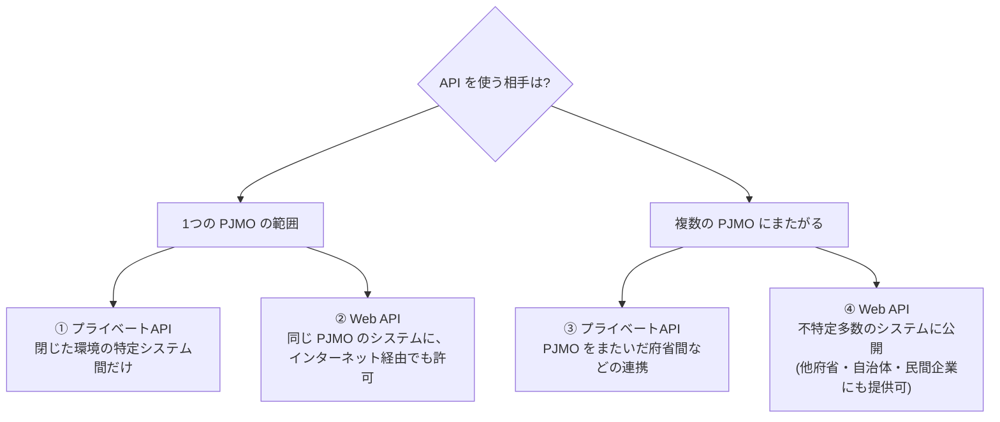

# 補章: ネットワーク接続とシステム間連携(AWS編)を読む

出典: GCASガイド[「ネットワーク接続方法(AWS編)」「システム間連携(AWS編)」](https://guide.gcas.cloud.go.jp/aws)、[ガバメントクラウド概要解説 3.3.3「ネットワークの全体像」](https://guide.gcas.cloud.go.jp/general)、[GCAS Connect 利用ガイド](https://guide.gcas.cloud.go.jp/gcas-user-guide)、リファレンスアーキテクチャの「閉域網の注意点」(別の補章を参照)
英訳は筆者の訳。カタカナの `/` は息継ぎ(ルールは [linking-rules.md](../linking-rules.md))。
「ガイド:」はGCASガイドに書かれていること、「推論:」は筆者の推論。
**注意**: 接続の「選択フロー」や、GSS(ガバメントソリューションサービス)を使う接続の詳細は、メンバー専用ページ(GCASアカウントが必要)にあり、読んでいない。

## 1. ネットワークの全体像(概要解説 3.3.3)

- ガイド: 国の行政機関では、一般ユーザーや各府省拠点からの接続、システム間連携の接続は、**セキュリティが十分に担保されたうえで、インターネット経由が基本**。同一CSP間のシステム連携は、CSPのサービスの利用を検討する。
- ガイド: 各府省拠点からの接続で、インターネット経由が許容できない場合は、**GSSネットワーク経由**や、**専用線を用いた閉域網**での接続を検討する。
- ガイド: 地方公共団体等は、「地方公共団体における情報セキュリティポリシーに関するガイドライン」に従って接続する。
- ガイド: 利用組織共通のサービス(共通サービス)への接続や、共通サービスのガバメントクラウドからの利用で使う接続も提供される。

## 2. AWSのネットワーク接続(ネットワーク接続方法(AWS編))

### どれを使うか

| つなぎたいもの | 推奨される方法 | 使い分け(ガイド) |
|---|---|---|
| VPC ↔ インターネット | **InternetGateway**、**NATゲートウェイ** | IGWは、パブリックサブネットのインスタンスと双方向に通信。プライベートサブネットに接続できない。**NATゲートウェイは、「インターネットへ出たいが、インターネットからはアクセスされたくない」とき**に使う。NATゲートウェイはパブリックサブネットに置き、そのためIGWが必ず必要 |
| VPC ↔ VPC | **VPCピアリング**、**AWS Transit Gateway** | 下の表を参照 |
| VPC ↔ AWSサービス | **VPCエンドポイント** | インターネットを経由せずに、AWSサービスとセキュアに接続。IGWもNATも不要で、VPCから到達できるAPIエンドポイントやサービスを制御できる |
| 他拠点 ↔ VPC | **インターネット経由が基本**、安定した専用帯域が要るなら**専用線(Direct Connect)** | Direct Connectは、インターネットを経由しないプライベート接続。VPN接続に比べて、**通信速度が安定**している |

- ガイド: 地方公共団体では、各団体の情報セキュリティポリシーに従って、インターネットに接続する。

### VPC同士: ピアリングとTransit Gateway

| | VPCピアリング | AWS Transit Gateway |
|---|---|---|
| 向いている場面 | 接続するVPCが**少なく**、今後も増えにくい | 接続するVPCが**多く**、今後も増えやすい。大量のVPCを集中管理して、管理コストを下げたい |
| 上限 | 1VPCあたり最大**125接続** | 1つあたり最大**5,000アタッチメント** |
| 特徴 | 同じアカウントでも別アカウントでもつながる。リージョン間ピアリングも可。**CIDRブロックが一致または重複するVPC間では使えない**(その場合は、AWS PrivateLinkを推奨) | リージョナルサービス。別リージョンのTransit Gatewayへは接続できないが、各リージョンのTransit Gateway同士は通信できる |
| 料金 | 接続自体は無料。**異なるアベイラビリティゾーン間のトラフィック量**にだけ課金 | アタッチメント料金に加え、時間あたりのアタッチメント数とトラフィック量に課金。ピアリングより**高い** |

- ガイド: GSSやクラウド接続サービス、各団体が独自に敷設する閉域網では、同一組織内のネットワークをTransit Gatewayで接続する。VPC間の接続は、自組織のネットワークを含めて最適な設計を検討する。

### VPCエンドポイントの2種類

| 種類 | 内容(ガイド) |
|---|---|
| インターフェイスVPCエンドポイント | PrivateLinkをサポートするAWSサービスが対象。**アクセス制御はセキュリティグループ**で行い、**マルチAZで配置**する |
| Gateway Load Balancerエンドポイント | Gateway Load Balancerのエンドポイントサービスが対象。ロードバランサーなので、セキュリティ製品の死活監視や AutoScaling にも対応 |

## 3. GCAS Connect(CSP間・共通サービスとのプライベート接続)

- ガイド: GCAS Connect(和名: GCASマルチクラウドネットワーク)は、デジタル庁が提供するネットワークサービス。2つの機能がある。

| 機能 | 内容 |
|---|---|
| P2P接続 | ガバメントクラウドの**異なるCSP間**のプライベート接続 |
| 共通サービス接続 | デジタル庁などが提供する**共通サービス(SaaSなど)**へのプライベート接続 |

- ガイド: 接続には、各CSPの閉域接続サービスを使う。AWSは **AWS Direct Connect**(本サービスで指定する Direct Connect パートナーの、**Hosted Connection型**の Transit VIF または Private VIF に対応)。
- ガイド: 各CSPとの物理的な接続は、サービス側で用意済み。利用者は、**GCAS Connectの申し込み**と、**各CSPの閉域接続サービスの設定**をするだけで開通できる。回線や機器の敷設は不要。
- ガイド: 納期は申請受領後、最大約**10開庁日**。サービスレベルの目標は24時間365日、可用性は月間**99.9%**(補償なし)。GCAS Connect自体の料金は発生しないが、**各CSPの閉域接続サービスの料金は、ガバメントクラウド利用料として請求**される(令和7年度現在)。
- ガイド: 「CSP同士の連携が不要なら、そのニーズが発生するまで、GCAS Connectの利用は不要」。ただし、共通サービスが GCAS Connect だけの接続を受け付けている場合は、単一のCSPの利用でも必要になる(よくある質問より)。
- 推論: 「マルチクラウドは原則禁止」(1つのシステム内)とは別の話。GCAS Connect は、異なる**システム間**や共通サービスとの接続のために、CSP同士をつなぐ仕組み。

## 4. システム間連携(AWS編)

### なぜAPI連携か

- ガイド: 従来の連携(ファイル転送、ディスク共有、データベース共有、RPCやWebサービスなどのアプリケーション連携、メッセージング)は、互いの依存が強い**密結合**で、1つのシステムの障害や変更の影響が全体に及びやすい。そのため、**比較的規模の小さいシステム間の連携に推奨**される。ガバメントクラウドでは、モダン化の観点から**API連携を推奨**する。
- ガイド: APIは、ソフトウェア同士がプログラムを共有するためのインターフェイス。提供側が公開する範囲を決めて公開し、利用側がアクセスすると、利用側はプログラムを開発せずに提供側のシステムを活用できる。**疎結合**になるので、互いに影響を与えずに、各システムが独立して機能拡張や入れ替えができる。HTTP/HTTPSでやり取りするので、端末やプログラム言語を問わない。

### 4つのAPI連携パターン

| パターン | 使う場面(ガイド) |
|---|---|
| ① 1つのPJMO: プライベートAPI | GSSとAWSのネットワークにつながった、1つのPJMO(または開発・運用事業者)の管理範囲のシステムだけにアクセスを許可。APIの存在は公にしない。閉じた環境内の特定のシステム間だけで連携したいとき |
| ② 1つのPJMO: Web API | 同じPJMO内のシステムなら、インターネット上からのアクセスも許可。自分で作ったAPIを、アプリや他のWebサービスの開発に活用したいとき |
| ③ 複数のPJMO: プライベートAPI | 同一PJMOだけでなく、複数の異なるPJMOの管理範囲のシステムからもアクセスを許可。APIの存在は公にしない。PJMOをまたいだ府省間などのシステム連携 |
| ④ 複数のPJMO: Web API | 不特定多数のシステムに、インターネット上からのアクセスを許可。他の府省や自治体だけでなく、民間企業のシステムにもAPIを提供できる |

### Amazon API Gateway と、認証・認可

- ガイド: API化の課題は、可用性やスケーラビリティを意識したインフラ管理、APIの設定やデプロイの制御、認証・認可の管理、スロットリング、セキュリティ管理。**Amazon API Gateway**は、APIの作成、公開、保守、モニタリング、保護を行うフルマネージドサービスで、これらを容易にする。Lambdaと組み合わせて、サーバレスなシステムを作れる。**プライベートAPI**(AWSのローカルネットワーク内からのアクセスを許可・拒否)と**パブリックAPI**(Webに公開)の両方を作れる。

| API | アクセス制限の方法(ガイド) |
|---|---|
| プライベートAPI | **IAMリソースポリシー**をインターフェイスVPCエンドポイントに付与して、VPC経由のプライベートなアクセスだけを許可する。APIに適用すると、どのシステムにどのAPIを提供し、どう使うか、他のAWSアカウントからのアクセスなどを、提供側が制御できる |
| パブリックAPI | **デフォルトでは、フルオープンで誰でもアクセスできる**。不特定多数のシステムからのアクセスを制限するには、IAMポリシー、リソースポリシー、AWS Signature Version 4、Lambdaオーソライザー、Amazon Cognito などを使う。IPアドレスやCIDRブロックからのリクエストの制御や、認証・認可を要求するAPIメソッドを設定できる。**AWS WAF**で、一般的なWebの脆弱性から保護する |

- ガイド: API Gatewayには、REST API、HTTP API、WebSocket APIがあり、それぞれ、アクセスの制御と管理の方法がある(AWSドキュメントへのリンク)。

## 5. 閉域網のときの注意(リファレンスアーキテクチャより)

別の補章(リファレンスアーキテクチャ)で読んだ内容を、ここでも確認する。閉域網でつなぐときは、次のように使えないものがある。

| サービス | 閉域網での扱い |
|---|---|
| CloudFront、QuickSight、Cognito、マネジメントコンソール | 使えない |
| API Gateway | **プライベートAPI(VPCエンドポイント経由)**で可能。ただし、プライベートAPIに対応するのは**REST APIだけ** |

- 推論: 上の「パブリックAPIの認証にCognitoを使う」は、閉域網では使えない。閉域網で認証が要るなら、Cognito以外(IAM認証、Lambdaオーソライザーなど)を検討する必要がある。ガイドは、この組み合わせまでは書いていない。

## 6. 「やったほうがいい / やめとけ」

| やったほうがいい | やめとけ |
|---|---|
| VPCが少なく増えないなら、VPCピアリング | VPCが何十もあるのに、ピアリングの網を張る(上限125、管理が複雑) |
| VPCが多く、増えるなら、Transit Gateway | 少数のVPCに、高いTransit Gatewayを使う |
| CIDRが重複するVPC同士は、PrivateLink | CIDRが重複しているのに、ピアリングで接続しようとする |
| 「インターネットへ出るだけ」なら、NATゲートウェイ | プライベートサブネットのインスタンスに、IGWを直接つなごうとする(できない) |
| AWSサービスへは、VPCエンドポイントでインターネットを経由せずに | セキュリティ要件が厳しいのに、IGWやNAT経由でAWSサービスに出る |
| 安定した帯域が要るなら、専用線(Direct Connect) | 帯域が安定しなければならないのに、インターネットだけに頼る |
| システム間は、API連携(疎結合) | ファイル転送・DB共有など、密結合な連携を大規模システム間に使う |
| プライベートAPIは、リソースポリシーとVPCエンドポイントで絞る | パブリックAPIを、認証・認可なしでフルオープンのままにする |
| 公開するWeb APIは、WAFで保護する | WAFなしで公開する |
| CSP間やデジタル庁の共通サービスとの接続は、GCAS Connect | 必要になる前に、早めに申し込む(CSP間の連携が不要なら、ニーズが出るまで不要) |

## 7. ガイドが書いていないこと

- 接続方法の**選択フロー**と、GSS・共通ネットワークを使った接続の詳細(メンバー専用ページ)。
- VPCのCIDRの具体的な設計や、サブネットの分け方。
- VPNの設定(Direct Connectとの比較で名前が出るだけ)。
- APIの設計(エンドポイントの切り方、バージョニング)の具体策(このガイドは連携の考え方と、API Gatewayの概要)。

## 8. 5文で言ってみる

### 1
- **日本語訳**: VPCが少ないなら、ピアリング。多いなら、Transit Gateway。
- **English**: Use peering for a few VPCs and Transit Gateway for many.
- **カタカナ**: ユーズピアリングフォアフュービーピーシーズ / アンドトランズィットゲイトウェイフォメニー

### 2
- **日本語訳**: AWSのサービスへは、インターネットを経由せずに接続する。
- **English**: Connect to AWS services without going through the internet.
- **カタカナ**: コネクトトゥエイダブリューエスサーヴィスィズ / ウィザウトゴウイングスルーズィインターネット

### 3
- **日本語訳**: システム間の連携は、APIを使う。
- **English**: Link systems through APIs.
- **カタカナ**: リンクシステムズスルーエイピーアイズ

### 4
- **日本語訳**: パブリックAPIは、そのままだと誰でもアクセスできる。
- **English**: A public API is open to anyone by default.
- **カタカナ**: アパブリックエイピーアイ / イズオウプントゥエニワンバイディフォールト

### 5
- **日本語訳**: 公開するAPIは、WAFで守る。
- **English**: Protect a public API with a WAF.
- **カタカナ**: プロテクトアパブリックエイピーアイ / ウィズアワフ

## 語彙

| English | カタカナ | 日本語 | 詳しい説明 |
|---|---|---|---|
| VPC (virtual private cloud) | ヴィーピーシー | VPC | AWS上に作る、自分専用の仮想ネットワーク |
| internet gateway | インターネットゲイトウェイ | インターネットゲートウェイ | VPCとインターネットの間で、双方向に通信するための出入り口 |
| NAT gateway | ナットゲイトウェイ | NATゲートウェイ | プライベートな側から、インターネットへ出ていくための出入り口(外からは入れない) |
| VPC peering | ヴィーピーシーピアリング | VPCピアリング | 2つのVPCを直接つなぐ仕組み |
| transit gateway | トランズィットゲイトウェイ | トランジットゲートウェイ | 多数のVPCや拠点を、ハブでまとめてつなぐ仕組み |
| VPC endpoint | ヴィーピーシーエンドポイント | VPCエンドポイント | インターネットを通らずに、AWSサービスへ接続する入口 |
| Direct Connect | ダイレクトコネクト | Direct Connect | 拠点とAWSを、専用線でつなぐサービス |
| API gateway | エイピーアイゲイトウェイ | APIゲートウェイ | APIの作成・公開・保護などを行う、マネージドサービス |
| authorizer | オーソライザー | オーソライザー | APIへのリクエストを許可するか判定する仕組み |
| closed network | クロウズドネットワーク | 閉域網 | インターネットに出ず、専用線などで閉じたネットワーク |

[← 大括りへ戻る](../overview.md)
