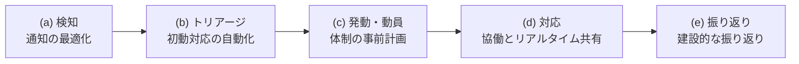
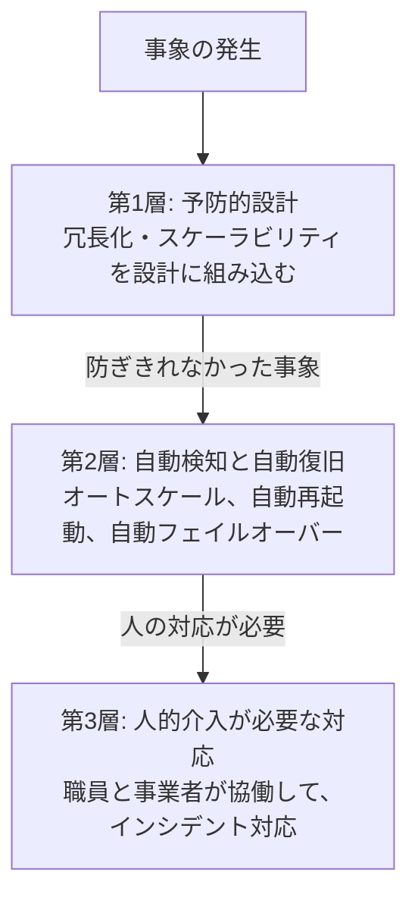

# 補章: 運用モダン化実践ガイドを読む(運用の進め方)

出典: [GCASガイド「運用モダン化実践ガイド」](https://guide.gcas.cloud.go.jp/modernization-guide)(第1〜4章)。第3章のIaC・CI/CDは、[IaC と CI/CD の補章](cicd-iac-practice.md)で扱ったので、ここでは信頼性設計と障害対応の自動化を中心に読んだ。
英訳は筆者の訳。カタカナの `/` は息継ぎ(ルールは [linking-rules.md](../linking-rules.md))。
「ガイド:」はGCASガイドに書かれていること、「推論:」は筆者の推論。
**注意**: このガイドは、CSPに依らない共通の内容。AWS特有の記述は少ない。別紙(セルフチェックリスト、ポストモーテムの雛形、振り返りの具体例)は、全部は読んでいない。

## 1. 何のガイドか

- ガイド: 職員と事業者が**協働**して、運用の適正化と、さらなる品質向上の両立を目指す。設計・開発の工程と、リリース後の運用の継続的改善の両方で使う。**設計段階が特に重要**。設計のときに、クラウドに適した運用の方式を作り込んでおかないと、リリース後に改善しようとしても、できることが限られるから。
- ガイド: 出発点は、「**インシデントを誘発する事象の発生は避けられない**」ということ。迅速に対応して、品質の低下を最小限に抑え、学びを次の改善につなげる。

### 3つの進化

| 進化 | 内容 |
|---|---|
| 協働と学習による継続的改善 | 従来は事業者に任せて、定期報告会で把握していた。職員と事業者が**対等**に、リアルタイムで情報を共有し、協働する。インシデントを「失敗」ではなく「**学習と改善の機会**」として捉える。責任追及ではなく、技術的な恒久対策で再発を防ぐ |
| 自動化による品質向上と効率化 | 手作業は、注意してもミスを完全には排除できない。IaCやCI/CDで自動化し、最終的には、本番に人が直接ログインしない**Zero Touch Production**を目指す |
| 利用者の体験を中心とした品質管理 | CPUやメモリの使用率の監視中心から、利用者が体験するレスポンスタイムやエラー率を測る**SLO / SLI**へ |

- ガイド: これらは、一度に全部実現する必要はない。優先度の高いものから段階的に取り組む。重要なのは、「現状よりも一歩でも前に進む」こと。
- ガイド: 既存システムでは、**2章(インシデント対応と振り返り)を最優先**で参照する。システム改修を伴わず、運用プロセスの改善だけでできて、効果が大きいから。3章の一部(定型作業のスクリプト化、ヘルスチェック連動の自動再起動)や、4章(既存の監視基盤を使ったSLO/SLI)も取り組みやすい。
- ガイド: 新規システムや大規模改修では、IaC、CI/CD、SLO/SLIを前提にした監視設計は、後から追加するのが難しいので、**設計段階から組み込む**。

## 2. インシデント対応と振り返り(2章)

### 用語の定義

| 用語 | 定義(ガイド) |
|---|---|
| 事象 | システム運用中に発生する、あらゆる出来事(正常な動作も、障害も含む) |
| インシデント | 事象のうち、**サービス提供に影響を及ぼしたもの**。実害はなかったが、一歩間違えば重大な事故につながる**ヒヤリハット**も含む。システム障害も、インシデントの一種 |
| 非インシデント | 事象のうち、サービス提供に影響を及ぼさなかったもの。冗長化や自動復旧で、影響を回避できたもの |
| インシデント対応チーム | インシデントの発生時に、原因究明と早期復旧を行う担当者の集まり。セキュリティだけでなく、障害対応も含む |

- ガイド: 非インシデントも、運用の記録として残して、分析対象にすることが望ましい。頻発するときは、潜在的な問題を示している。短期間に繰り返し発生したり、複数が同時に発生したりすると、次にインシデントへ発展するリスクが高まる。

### なぜ「発生する前提」で考えるのか

- ガイド: システム品質を上げるために、設計・テストで全部の障害を作り込もうとしたり、影響を限りなくゼロにしようとしたりするのは、**コストの指数関数的な増加をもたらす非現実的なアプローチ**。設計・構築・テストで、品質をある程度まで高めたうえで、**リリース後にインシデントが一定程度発生することを前提に**、迅速な対応と、振り返りによる技術的な恒久対策で、継続的に改善する。

### インシデント対応の5つのフェーズと、品質向上のアプローチ

- ガイド: 検知では、通知頻度を適正にして、**アラート疲れ**を防ぐ。AIによる異常検知(AIOps)の活用も考えられる。

### 役割と体制

| 役割 | 内容 |
|---|---|
| 現場指揮官(インシデントコマンダー) | チーム全体を統括し、意思決定をする責任者。**必ず必要**。全体を俯瞰して判断することに集中するため、**実作業はしない**(最初に実作業担当を立てる)。上司は、全権限を現場指揮官に委任し、支援と助言に徹する |
| コミュニケーションリード | ステークホルダーとの窓口担当を取りまとめる |
| オペレーションリード | 実作業担当を取りまとめる。実作業担当が**5名前後**を超えたら、立てる |
| 記録担当 | 情報を一元的に記録する |
| 窓口担当 | チーム外のステークホルダー(利用者、関連組織、製品ベンダーのサポートなど)との連絡 |
| 実作業担当 | 状況の把握、原因調査、復旧作業 |

- ガイド: 構成の考え方は、現場指揮官だけの状態を出発点に、参加者に役割を順に委任する。現実的な**最小構成は、現場指揮官と実作業担当の2名**。5名の例は、実作業担当3名、コミュニケーション担当1名、現場指揮官1名。

### 職員と事業者の責任

- ガイド: インシデント対応を**事業者だけで行うのは好ましくない**。事業者は限られた情報しか接することができず、契約に基づく活動で、範囲が契約の内容に制限される。職員と全く対等な立場・目線で行動するのは、本質的に難しい。職員もチームの一員になる。

| | 責務(ガイド) |
|---|---|
| 職員 | **外部ステークホルダーとのコミュニケーション**。サービスの提供責任者として、利用者や関連組織へ情報提供し、不安や不満を減らす。影響を把握してチーム内に共有する。必要に応じて外部支援を調達する |
| 事業者 | **原因究明と解決**。技術的・業務的な専門家として、早期復旧する。窓口の職員に必要な情報を逐次提供する |

- ガイド: 内製化の状況で変わる。職員が現場指揮官を担うのが理想だが、事業者への依存が大きい「仕様内製型」では、事業者のリーダーが担うこともやむを得ない。
- ガイド: **チーム外の人が、対応チームの担当者に直接コンタクトするのを遮断する**(上司が担当者を捕まえて聞く、現場指揮官を介さず直接指示する、など)。集中が途切れて、対応の質とスピードが落ち、指示系統が複数になって混乱するから。対策は、リアルタイム共有ツールを参照してもらうこと、専任の連絡担当者(コミュニケーター)を置くこと。

### 事前の計画

- ガイド: **現場指揮官の優先順位リスト**(第二候補、第三候補まで)を、平常時に決める。夜間・休日も連絡がつく人を考慮する。体制人数ごとの役割分担(誰が何を兼務するか)も決めておく。役割ごとに、主担当と副担当を決める。
- ガイド: **初動は多めに招集**して、状況が明確になったら縮小する。後から人を逐次投入すると、そのたびに状況説明に時間を取られ、情報の食い違いや重複作業が起きるから。
- ガイド: 体制は、人事異動、システムの大規模変更、インシデント後などに見直す。訓練で機能するかを検証する。**まずは現場指揮官の担当者を決めることから始め**、経験しながら拡充する。完璧を最初から目指さない。

### リアルタイム共有

- ガイド: 複数人が同時に更新・参照できるツールを使う。オンサイトならホワイトボード、リモートなら同時編集できるwikiやドキュメント。
- ガイド: 共有する情報は6つ。①発生日時と事象概要、②ユーザー影響、③時系列の対応経緯、④各担当者の役割分担、⑤直接原因(簡易な構成図で可視化できるとなおよい)、⑥今後の対応方針。①②⑤は、判明している範囲で書いて、逐次更新する。

### 振り返り(ポストモーテム)

- ガイド: 目的は、同様のインシデントの再発防止と、発生時の影響の最小化。「失敗を責める場」ではなく、「学習と改善の機会」。
- ガイド: **非難しない文化(ブレームレス)**。「誰が悪いか」ではなく「何が悪かったか」「どうすれば防げたか」に焦点を当てる。人為的ミスも、「なぜそのミスが起こりうる状況だったか」を、システムとプロセスの観点から分析する。理由は、心理的安全性の確保、本質的な問題の発見、継続的な改善の促進、担当者の成長。

| ブレームレスの注意点(ガイド) |
|---|
| 「責任を問わない」という意味ではない。悪意ある行為や重大な規則違反は、通常の懲戒プロセスで対処する |
| 個人を責めないことと、失敗から学ぶ機会を提供することは両立する |
| 組織としての責任(ミスを発見するプロセスの不備、体制の問題)は明確にする |
| **契約上の責任と、振り返りは分離する**。請負契約の瑕疵担保責任や損害賠償の協議は、別に行う。振り返りの場で契約上の責任追及をしないことで、率直に報告できる環境を保つ |

- ガイド: 基本原則は6つ。①**タイムリーに**(目安は解決後1週間以内)、②職員と事業者を含む関係者全員が**対等に**参加、③ログやデータの**客観的な事実**に基づく、④建設的な議論(「どうすればより良くできたか」)、⑤文書化して共有、⑥**アクションを明確にして追跡**(責任者、期限、優先度)。

### 運用回避ではなく、技術的な恒久対策を優先する

- ガイド: 再発防止策として、「人手による運用強化」や「チェックリストの整備」が提案されがちだが、**技術的な恒久対策がある場合は、それを優先**する。

| 運用回避の問題点(ガイド) | 技術的恒久対策の利点(ガイド) |
|---|---|
| 人為的ミスは必ず発生する(「次は気をつける」は根本的な解決にならない) | 確実(自動化で人為的ミスを排除) |
| 規模に応じて人員を増やす必要があり、スケールしない | 一度実装すれば、規模にかかわらず同じ品質 |
| 特定の担当者に依存し、異動や退職で破綻する(属人化) | 人員の異動や増減に影響されず、長期的に効果がある |
| チェックリストや手順書が人的リソースを消費し続ける | 人手を付加価値の高い業務に集中できる |
| 担当者のスキルや状況で品質がばらつく | 常に同じ品質で処理される |
| インシデントのたびに項目が増え、形骸化する | 知識がコードやシステム設計として形式知化され、組織の資産になる |

## 3. 障害対応の自動化(3章 3.6)と、信頼性設計

### 3つの層で、事象を「非インシデント化」する

- ガイド: 第1層と第2層は、事象を「非インシデント」として吸収する。第3層が、「インシデント」への対応を担う。

### 第1層: 予防的設計の評価観点

| 観点 | ガイドの記述 |
|---|---|
| 冗長化とスケーラビリティ | 単一障害点(SPOF)を排除する。コンポーネントを、異なる耐障害性ゾーン(AWSはAvailability Zone)やリージョンに分散配置する。オートスケールなら、スケールアウトとスケールインの閾値と、上限を確認する |
| データ保護 | マネージドサービスの自動バックアップ。遠隔地の要件、RPO・RTO、**バックアップからの復旧手順の定期的なテスト**。CSPが公表する耐久性のSLAは、満たされなくても**返金されるだけで、消失したデータが復旧するわけではない**。重要なデータは、複数世代、遠隔地レプリケーションなどを検討する |
| 障害影響の局所化 | **サーキットブレーカー**で障害の連鎖を防ぐ。サービス間を非同期にする。**タイムアウト**を適切に設定する(長すぎると待ち続け、短すぎると正常な処理でもタイムアウト)。連鎖的な障害(カスケード障害)の防止 |

### 第2層: 自動復旧のパターン

| パターン | ガイドの記述 |
|---|---|
| オートスケール | 負荷急増に自動で対応。**DoS攻撃などで過剰にスケールすると、想定外のコストが出る**ので、上限値を設定するか、コスト監視とアラートを組み合わせる。**すべてのシステムでオートスケールが必要なわけではない**(負荷の変動が少ない、稼働期間が短い、パターンが予測できる場合は、適切にサイジングした固定構成のほうが、運用がシンプル) |
| ヘルスチェック連動の自動再起動 | アプリのハングやメモリ不足に有効。アプリ側で、永続化すべきデータをプロセス内に保持せず(キャッシュやDBに保存)、再実行しても結果が同じになる**冪等性**を保つ。ヘルスチェックの間隔(長いと検知が遅れ、短いと誤検知)と、連続失敗の回数の閾値は、障害テストで検証する |
| DBの自動フェイルオーバー | スタンバイへ自動で切り替わる。**同期レプリケーション**は整合性を保証するが書き込み性能に影響、**非同期**は性能への影響が少ないが、直近の更新が失われる可能性がある。RPOと性能のバランスで選ぶ。フェイルオーバー後の新しいプライマリは、元と同等の性能が必要。**アプリ側にも、DB接続の自動復旧と、クエリの自動再実行**が要る |

- ガイド: **自動対応は、人が介入しないので、問題があっても気づきにくい**。動作状況を継続的に監視・分析する。**自動復旧が短時間に連続して実行される**のは、根本の問題が解決していない印。アラートを出し、必要なら一時的に自動復旧を止めて、人の介入を促す。
- ガイド: 自動で縮小しないリソース(DBのストレージ容量など)は、一時的な負荷増加のあとも拡張されたままなので、定期的に確認する。

### 信頼性設計の評価と検証

| 手法 | 内容 |
|---|---|
| FMEA(故障モード影響解析) | 構成要素ごとに障害モードを洗い出し、**影響度、発生頻度、検知難易度**で評価して、優先度を決める。例: Webサーバーの停止は影響度が高いので、冗長化と自動復旧の両方。ロードバランサーのヘルスチェック誤検知は影響度が低いので、閾値調整 |
| V字モデル | 設計の各段階に対応するテストを定義する。基本設計の冗長化 → システムテストで一部のサーバーを止めても継続することを確認。詳細設計の自動復旧 → 結合テストで自動再起動を検証。アジャイルでも、スプリントごとに設計とテストを同時に定義 |
| 設計レビュー | **四半期ごと**を目安に、運用実績や環境の変化に応じて見直す |
| 障害テスト | 負荷テスト(段階的な増加、スパイク、持続)、障害テスト(インスタンスの停止、ネットワークの分断、DB接続の切断、災対環境への切り替えと切り戻し)。リリース前に実施し、運用中も、変更に応じて継続的に |
| 障害対応訓練 | 自動化だけでは対応できない事象に、運用者が適切に対応できることを確認 |

### 第3層: 人的介入が必要な対応の準備

- ガイド: 職員と事業者が離れた拠点にいるのが多いので、リモート対応の体制とツール(リモート会議、チャット、同時編集のドキュメント)を整える。**事業者が独自判断でできる復旧作業の範囲と、職員の承認が必要な作業の境界を明確**にして、承認の遅延や、無断実施による二次被害を避ける。24時間365日が必要なら、オンコール体制。
- ガイド: 緊急時のアクセスは、Zero Touch Productionを維持しつつ、権限昇格に申請・承認と操作ログの記録を設ける(IaCとCI/CDの補章を参照)。
- ガイド: 複雑な障害や未経験の事象は、**CSPのサポート**と連携する。事前にサポートプランを選んで、エスカレーション手順を決めておく。起票時は、状況、影響範囲、実施済みの対応を正確に伝える。過去のケースは記録として保管する。

## 4. サービスレベルの定義・計測(4章)

### KPI、SLO、SLI

| 階層 | 内容 | 例 |
|---|---|---|
| KPI(重要業績評価指標) | 組織やサービスの目標達成度。最上位 | オンライン申請率、利用者満足度、処理完了日数 |
| SLO(サービスレベル目標) | KPIを達成するために、システムが満たす技術的な目標値 | 申請処理の成功率が99%以上、2秒以内に応答した割合が95%以上 |
| SLI(サービスレベル指標) | SLOの達成状況を測る指標 | HTTP 5XXエラー数 / 全リクエスト数 |

- ガイド: **利用者の体験に直結する指標**を重視する。CPUやメモリの使用率は、利用者が体験する品質と、必ずしも相関しない(CPU使用率が低くても応答が遅いことがあり、高くても性能が保てることもある)。
- ガイド: サービスレベルが目標を下回ったときは、責任追及ではなく、**維持・向上のメカニズム**(問題の自動検知・対応、作業の自動化)の検討に注力する。人による24時間365日の監視や、人手のチェックの追加は、不完全な対策。

### 決め方: 2つのアプローチの組み合わせ

| アプローチ | 出発点 | 内容 |
|---|---|---|
| トップダウン | 組織やサービスの戦略的目的 | KGI/KPIから、必要なSLOを導く。改善が組織目標に貢献する |
| ボトムアップ | 利用者の体験 | クリティカルユーザージャーニー(CUJ)を分析して、利用者の要求を直接反映したSLOを設定する |

- ガイド: 両方を組み合わせる。特に、**設定したSLOがKPIの達成にどれくらい貢献するか**の整合性を明確にする。すべてのSLOがKPIと直接関連している必要はない。

ボトムアップの4ステップ(ガイド):

1. **CUJの抽出**: 利用者インタビュー、アクセスログの分析、業務フロー分析、関係者とのワークショップ。例(電子申請): 申請の提出(フォーム入力 → 内容確認 → 送信)、ステータス確認、問い合わせ。**最初は1〜2件**から始める。
2. **要求の特定とSLIの定義**: 例: 「スピーディに送信したい」→ 送信から完了応答までが2秒以下の割合(レスポンスタイム)。「確実に送信したい」→ エラー応答となる割合(エラー率)。
3. **SLOの目標値の設定**: 「利用者の要求を満たせるか」と「現実的に達成できるか」のバランス。初期は達成可能性を重視し、成熟度に応じて引き上げる。例: 可用性を99.9%から99.99%にするには、冗長化や運用体制の大幅な強化が要る。
4. **KPIとの整合性の確認**。

### 数を絞る

- ガイド: SLO/SLIは、運用開始時に網羅的に作らず、優先度の高いものを最小限で定義して、**段階的に追加**する。サービス開始前は不確定要素が多く、実態にそぐわない指標が含まれるリスクがある。一度合意した指標は、不要になっても削除しにくく、保守運用の負担が増える。
- ガイド: 絞り込みの3基準: **A. 利用者の体験への直接影響が高い、B. 測定が容易で既存の基盤で取得できる、C. サービス品質への影響を定量化できる**。例: ロードバランサーのHTTP 5XXエラー数から、エラー発生率を計算する。
- ガイド: SLIの例。オンライン処理は、**成功レスポンス率**(2xx・3xxの件数 / 全リクエスト)と**応答時間**(2秒以内の件数 / 全成功リクエスト)。非同期処理は、**データ鮮度**(1時間以内に更新されたデータ件数 / 全データ件数)と**処理カバレッジ**(完了した処理件数 / 予定処理件数)。

### 稼働率の目標値の注意

- ガイド: 稼働率は馴染みがあるので、CSPのサービスやアーキテクチャの想定を考えずに、イメージで目標値を決めがち。すると、**価値や停止時の損失に比べて、過大なコストをかけた構成や運用**になる。無理な目標を達成するために、稼働率の例外条件を設定したり、**インシデントを隠蔽**したりする品質低下のリスクもある。過剰に高い目標値を設定せず、**停止時影響の許容度と、コストと稼働率が釣り合う点**を起点にする。

### 計測と可視化

- ガイド: データの収集は、**APMツール**、ロードバランサーなどの標準メトリクス、**外形監視ツール**。SLOの評価には、過去1時間や30日間などの集計期間が必要。
- ガイド: データ欠損時の扱い(正常時間・異常時間・計算対象外)を選べるようにする。複数の集計期間(日次、週次、月次)を用意する。ばらつきが大きい指標(国民からのページロード時間など)は、**90または95パーセンタイル**で評価する。
- ガイド: 計測の仕組みは、**CSPのマネージドサービスを活用**する。専用の**ダッシュボード**で、リアルタイムと複数の時間軸の推移を可視化する。手動の指標収集やレポート作成が不要になる。AWS編には、サンプルダッシュボードがある(「定量的計測の実装方法(AWS編)」。今回は読んでいない)。
- ガイド: **アラート**は、急激な低下の検知用。例: 過去5分間の達成率が90%を下回ったら緊急度「中」、80%を下回ったら「高」。中長期の推移はアラートではなく、ダッシュボードで継続的に監視する。

### 継続的な改善

- ガイド: 改善は2つの軸。①SLO/SLIに基づくシステムの改善(傾向分析と潜在課題の発見 → 計画の策定(SLOへの影響度、発生頻度、工数で優先順位) → 効果の継続的評価(例: SLO達成率 90%→95%、インシデント件数 15→8件、平均復旧時間 4時間→2時間))、②SLO自体の見直し。
- ガイド: SLOの見直しの理由は、組織目標(KPI)との乖離の防止、環境変化への適応、現実的な目標の維持。**SLOを達成していても、利用者のフィードバックで満足度が低いなら、SLOと実際の体験が乖離**しているので、SLIの再定義が必要かもしれない。マイクロサービスやサーバレスへの移行で、従来の指標では評価できなくなることもある。

## 5. 「やったほうがいい / やめとけ」のまとめ

| やったほうがいい | やめとけ |
|---|---|
| インシデントは**発生する前提**で、体制を事前に決める(まず現場指揮官の優先順位リスト) | インシデントを完全になくそうとして、コストを指数関数的に増やす |
| 職員と事業者が**対等**に、チームとして対応する | 事業者だけで対応する |
| 現場指揮官は**判断に集中**し、実作業は別の担当者に任せる | 現場指揮官が実作業をする。上司が現場指揮官を飛び越えて指示する |
| チーム外には、**共有ツールを参照**してもらう | 担当者を捕まえて、直接状況を聞く |
| 初動は**多めに招集**し、あとで縮小する | 人を逐次投入する |
| 同時編集できるツールで**リアルタイムに共有** | 口頭と個別連絡だけで済ませる |
| **ブレームレス**で、「何が悪かったか」に焦点を当てる。契約上の責任は別に協議する | 個人を責める。振り返りの場で契約上の責任を追及する |
| 振り返りは**1週間以内**に、事実(ログ)に基づいて、アクションの責任者と期限を決める | 時間が経ってから、憶測で議論する |
| **技術的な恒久対策**を優先する | 「次は気をつける」、チェックリストの追加(形骸化する) |
| 冗長化とサーキットブレーカー、タイムアウトで障害影響を**局所化** | 単一障害点を放置する |
| 自動復旧の**連続実行を検知**して通報する | 自動復旧を入れたら安心して、監視しない |
| **利用者の体験**(応答時間、エラー率)をSLIにする | CPUやメモリの使用率だけを見る |
| SLO/SLIは**最小限から始めて**、段階的に追加する | 運用開始時に網羅的に定義する |
| 稼働率は、**停止時影響とコストが釣り合う点**を起点に決める | イメージで過剰に高い稼働率を設定し、例外条件やインシデントの隠蔽に走る |
| SLOを定期的に**見直す** | 一度決めたSLOを放置する |

## 6. AWSでは

- ガイド: このガイドはCSPに依らない共通の内容で、AWSのサービス名はほとんど出てこない。AWSの用語は、耐障害性ゾーンが「Availability Zone」であることくらい。
- ガイド: AWS向けのサンプルは、別資料「定量的計測の実装方法(AWS編)」にある(サンプルのダッシュボード)。今回は読んでいない。
- 推論: AWSでの実現には、[マネージドサービス活用実践ガイドの補章](managed-service-practice.md)の、ヘルスチェック、ロードバランサーのメトリクス、外形監視、APMの考え方が、そのまま使える。

## 7. ガイドが書いていないこと(読んだ範囲)

- AWSの具体的なサービスでの、SLI/SLOの設定手順(別資料)。
- 稼働率の具体的な数値の基準(参照先としてデジタル・ガバメント推進標準ガイドラインを案内)。
- 推論: 別紙(セルフチェックリスト、ポストモーテムの雛形、振り返りの具体例、技術的恒久対策の具体例)は、実務で使うときに読む価値がある。

## 8. 5文で言ってみる

### 1
- **日本語訳**: インシデントは、起きる前提で備える。
- **English**: Prepare for incidents on the assumption that they will happen.
- **カタカナ**: プリペアフォーインスィデンツ / オンジアサンプションザットゼイウィルハプン

### 2
- **日本語訳**: 「誰が悪いか」ではなく、「何が悪かったか」を問う。
- **English**: Ask what went wrong, not who was wrong.
- **カタカナ**: アスクワットウェントロング / ナットフーワズロング

### 3
- **日本語訳**: 運用でカバーせず、技術で再発を防ぐ。
- **English**: Prevent recurrence with technology, not with manual rules.
- **カタカナ**: プリヴェントリカーレンスウィズテクナロジー / ナットウィズマニュアルルールズ

### 4
- **日本語訳**: CPU使用率ではなく、利用者の体験を測る。
- **English**: Measure the user experience, not the CPU usage.
- **カタカナ**: メジャージユーザーイクスピアリエンス / ナットザスィーピーユーユースィジ

### 5
- **日本語訳**: 小さく始めて、指標を少しずつ増やす。
- **English**: Start small and add metrics gradually.
- **カタカナ**: スタートスモール / アンダッドメトリクスグラジュアリ

## 語彙

| English | カタカナ | 日本語 | 詳しい説明 |
|---|---|---|---|
| incident | インスィデント | インシデント | サービスの提供に影響が出た事象。ヒヤリハットも含む |
| incident commander | インスィデントコマンダー | 現場指揮官 | インシデント対応の指揮と意思決定をする責任者 |
| postmortem | ポウストモーテム | ポストモーテム(振り返り) | インシデントの後に、原因と改善策を話し合う振り返り |
| blameless | ブレイムレス | ブレームレス(非難しない) | 人ではなく、仕組みに焦点を当てる考え方 |
| SLO / SLI | エスエルオー / エスエルアイ | サービスレベル目標 / 指標 | 目標値 / それを測る指標 |
| KPI | ケーピーアイ | 重要業績評価指標 | 組織の目標達成度を測る最上位の指標 |
| critical user journey (CUJ) | クリティカルユーザージャーニー | クリティカルユーザージャーニー | 利用者が達成したい、最も重要なタスクに至る一連の体験 |
| idempotent | アイデンポウテント | 冪等 | 何度実行しても、結果が同じになる性質 |
| circuit breaker | サーキットブレイカー | サーキットブレーカー | 不調な相手への呼び出しを一時的に止めて、障害の連鎖を防ぐ仕組み |
| FMEA | エフエムイーエー | 故障モード影響解析 | 起こりうる故障を洗い出し、影響度などで優先度をつける手法 |
| percentile | パーセンタイル | パーセンタイル | 小さい順に並べて、何%の位置にある値か。外れ値の影響を避ける |

[← 大括りへ戻る](../overview.md)
