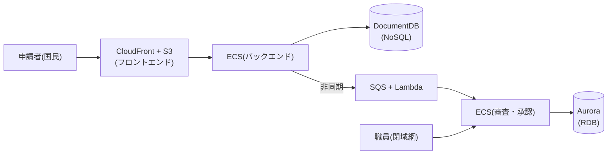

# 補章: リファレンスアーキテクチャを読む(設計全般)

出典: [GCASガイド「リファレンスアーキテクチャ全体概要」](https://guide.gcas.cloud.go.jp/csp-common-others)(第1〜5章)。第4章のシステムパターンは、AWSの「電子申請・審査システム」を例に読んだ。
英訳は筆者の訳。カタカナの `/` は息継ぎ(ルールは [linking-rules.md](../linking-rules.md))。
「ガイド:」はGCASガイドに書かれていること、「推論:」は筆者の推論、「ガイド外:」はガイドに書かれていない情報。

## 1. リファレンスアーキテクチャとは

- ガイド: ガバメントクラウドへの**Rebuild移行(R2)**で、システム構成の設計を進めるための「**設計の出発点**」。行政システムに共通する機能を「**ブロック**」として整理し、システムパターンとCSP別の実装例を組み合わせる。
- ガイド: 期待する効果は3つ。ゼロからの設計を避けて**設計の工数を減らす**、優れた設計を共有して**品質を標準化する**、見積りと調達仕様書の**品質と生産性を上げる**。
- ガイド: 網羅的ではない。必要なブロックはシステムの要件に応じて足す。特殊・例外的なシステムは、ブロックの技術要素を参考に独自に検討する。**非機能ブロックは、そのような場合でも共通で使える**。
- ガイド: 利用者は、PJMO(計画・予算要求・調達の構成検討、調達仕様書)と、事業者(調達・設計・構築のアーキテクチャ設計)。

### 4つの構成要素と、読む順番

| 要素 | 内容 |
|---|---|
| ブロック一覧 | 多くの行政システムに必要な機能を、業務ブロック・非機能ブロックとして一覧化 |
| 代表的なシステムパターン | ブロックの組み合わせ例。「共用サービス化も可能」なものは、プロジェクト・事業者・府省単位での共用サービス化やSaaS化も想定される |
| システムアーキテクチャ例 | 代表的なシステムの構成例(一定の最適化済み) |
| ブロック実現例 | 各ブロックのCSP上の具体的な実装例 |

- ガイド: 流れは、**ブロック一覧を起点に、パターンとアーキテクチャ例で全体像を具体化し、最後にブロック実現例で実装レベルを確認する**。
- ガイド: **システム構築のベースにするCSPは、原則として1つ**。ただし、SaaSや共通サービスが別のCSPなのは問題ない(「マルチクラウドは原則禁止」の考え方と同じ)。

## 2. 工程別の使い方(第2章)

| 工程 | 内容 | リファレンスアーキテクチャ |
|---|---|---|
| システム計画: システム要件抽出 | 機能・非機能の要件と調達スコープを整理する。目的は、**要件の決定ではなく、移行の方向性を固める**こと | **使わない** |
| 予算要求: ブロックマッピング・見積もり取得 | 機能一覧をブロックに紐づけ、システム全体像を描き、概算見積りを取る | **ここで最初に使う** |
| 調達: アーキテクチャ最適化 | 事業者が主体で、ブロック間連携の具体化、非機能要件によるブロックの見直し、過不足なサービスの洗い出しをする | 使う |
| 調達: 仕様書反映 | 構成図を調達仕様書に反映し、RFPと各種申請を行う | **使わない** |

- ガイド: ゴールは、予算要求では「ブロック選定後のシステム全体構成図」と「クラウド利用料の概算見積り」。調達の最適化では「最適化後の全体構成図」(詳細設計レベルは不要。後続の設計のガイドラインとなる粒度でよい)。
- ガイド: 各作業は、**モダン技術に明るい事業者**に依頼することが望ましい。システム刷新では、PMOに**クラウドCoE**を併設し、各工程で相談することを推奨する。
- ガイド: 予算要求の作業は、機能・非機能要件とブロックの対応表 → システムパターンの流用(ブロックレベルの全体構成図) → ブロックのマッピング(連携先の端末、SaaS、マーケットプレイス製品も含める) → 仮選定したCSPのリファレンスアーキテクチャでサービスレベルの構成図 → RFI、事業者の修正、CSPの計算ツールでの見積り(開発・検証・災対環境など、すべて含める)。

## 3. ブロック一覧(第3章)

### 業務ブロック(行政業務に直接関わる機能)

| 分類 | 代表的なブロック |
|---|---|
| 利用者認証 | 本人確認機能(レベルA/B/C) |
| 申請・届出 | 申請・届出、添付資料管理、ステータス管理、公文書ダウンロード/公開、手数料の電子納付、補助金の電子交付、電子決裁 |
| 審査・承認 | 審査・承認機能 |
| データ管理 | データ連携、データ収集、分析用ダッシュボード、統計処理、統計情報公開、文書検索、IoT連携、大量データ取り込み |
| 利用者通知 | メッセージ通知、プッシュ通知、アラート通知 |
| コンテンツ管理 | 静的/動的Webページ公開、CMS |
| コミュニケーション | 問い合わせフォーム、コールセンター/チャット、チャットボット、ヘルプデスク支援 |
| 外部連携 | 申請処理連携、API公開 |
| 書類出力 | 書類出力、法定帳票作成(外部/内部) |
| スマホアプリ連携 | スマホアプリ連携機能 |

### 非機能ブロック(業務を支える共通の機能)

| 分類 | 代表的なブロック | 非機能推奨 |
|---|---|---|
| 利用者認証 | ユーザ認証(国民向け / 企業ユーザ向け / 職員向け) | |
| 外部連携 | システム間認証 | |
| セキュリティ | セキュリティ管理(検知・ダッシュボード・通知)、通信を介した攻撃への保護(WAF、Shield Advanced、SG、CloudFront、SSL強制)、保管データの暗号化 | ○ ○ ○ |
| ネットワーク | 行政システム・拠点とのネットワーク接続性の確立 | |
| 構成管理 | システム構成管理 | ○ |
| バックアップ | バックアップ(リージョンまたぎを含む) | ○ |
| オブザーバビリティ | システム監視、サービス状態監視(外形監視)、KPI可視化 | ○ ○ |
| ログ管理 | ログ管理 | ○ |
| CI/CD | CI/CDパイプライン | |
| データ共有 | 複数組織データ分離格納方法 | |
| 機械学習・AI | 機械学習・AI機能 | |
| メンテナンス | DB直接メンテナンス、起動停止スケジューリング(コスト抑制) | |
| コスト管理 | 課金管理(予算超過の通知) | |
| その他 | API管理、ローコード開発、既存政府システムとの連携 | |

- ガイド: **非機能推奨ブロック**(8つ)は、必須ではないが実装を強く推奨する。優先的に取り込みを検討する。
- ガイド: 各ブロックに、「共用サービス化も可能」か「個別に実装」かが書かれている。たとえば、ユーザ認証、メッセージ通知、API公開、書類出力などは共用サービス化も可能。ステータス管理、電子決裁、審査・承認、統計処理、セキュリティ管理などは個別に実装。

## 4. 代表的なシステムパターン(第4章)

- ガイド: 手順は、①表からシステムパターンを選ぶ → ②利用予定のCSPの列が「○」であることを確認する → ③該当パターンの構成図をベースに、ブロックを選ぶ。複数のパターンの組み合わせも想定される。

| # | システムパターン | 主な用途 |
|---|---|---|
| 1 | 電子申請・審査システム | 国民や職員が申請し、職員が審査・承認する |
| 2 | 税金関連システム | 税金の申告・納付・還付など、金銭処理を伴う |
| 3 | 許認可関連システム | 許認可の申請・審査・承認 |
| 4 | データ収集・公開システム | 災害・気象情報などの大量データを収集・分析・公開 |
| 5 | 人事系システム | 職員の人事情報の申請・審査・管理 |
| 6 | オンライン調査システム | 国民対象の調査の配信・回収・集計 |
| 7 | データ管理型システム | 防災、施設管理、地図情報、IoT機器のデータ管理 |
| 8 | 府省庁Webサイト | 情報公開、問い合わせ対応 |
| 9 | 統計システム | 統計データの収集・処理・公開 |
| 10 | 資格管理システム | 国民の資格情報の管理・照会・外部連携 |
| 11 | 地図データ関連システム | 地図情報の表示・検索・管理(AWSのみ対応) |

### 例: AWSの「電子申請・審査システム」から、設計の考え方を読む

| 設計判断 | ガイドの理由 |
|---|---|
| 申請・届出のDBは**NoSQL** | 国民からの大量のリクエストが一度に来るので、高いスケーラビリティが要る。処理の中心は新規登録(インサート)で、トランザクションが求められることは少ない。ユーザの属性情報はシステム更改で増える可能性があり、事前のスキーマ定義が不要なNoSQLが向く |
| 審査・承認のDBは**RDB** | 利用者は審査担当の職員だけで、高いスケーラビリティは不要。審査の処理で、トランザクションが必要になることが多い |
| 申請・届出と審査・承認の連携は**非同期(メッセージキュー)** | 柔軟性と拡張性が高まる。各サービスが独立して動いて、スケールや更新がしやすい。ネットワーク遅延や一時的なダウンにも強い |
| 審査・承認側は、**CDNを使わない** | 職員は閉域網経由で接続する前提で、CDNは、インターネット経由が前提だから |
| 申請・届出は、**フロントとバックを分離**(コンテナ) | 申請側は、フロントを CDN+オブジェクトストレージで実現。審査側は、フロントとバックを別々のECSタスクで動かす |
| ユーザ認証ブロックは、**アプリの一部**として実現 | 専用のDBなどは想定しない。**過度な分割は避け**、フレームワークやライブラリで構築を効率化する |
| 認証は**外部のID管理システム**と連携 | OpenID ConnectやSAML 2.0などの標準プロトコルで連携する。国民認証はマイナ認証、職員認証はGIMA(構成図の説明より) |

- 推論: 同じシステムの中で、サブシステムごとにDBの種類を変えているのは、「データの種類で選ぶ」(DBの補章)の実例。

## 5. 設計時の留意事項(第5章)

### 災害対策(DR)

| パターン | ガイドの記述 |
|---|---|
| マルチゾーン(シングルリージョン) | リージョン内の複数ゾーンで冗長化。**リージョン全域の大規模災害を想定しない場合でも、可用性向上のため、マルチゾーン構成を推奨**。マルチゾーンのマネージドサービスなら、ゾーン被災への手順準備は基本的に不要。ただし、**ゾーン被災を考慮すべきマネージドサービスもある**ので、サービスのドキュメントで確認して、必要に応じて冗長化やバックアップをする |
| バックアップ | 本番リージョンのバックアップを、災対リージョンへ転送。**手動のバックアップはせず**、CSPのバックアップサービスで。バックアップサービスの対象外のサービスは、独自のバックアップ処理が必要かを事前に確認する |
| ウォームスタンバイ | 「更新予定」(読んだ時点で未記載) |
| アクティブ-アクティブ | 「更新予定」(読んだ時点で未記載) |

- ガイド: システムの業務特性で、必要な災害対策は異なる。**費用対効果が高く、要求に適したレジリエンス(回復力)**を実現する構成を検討する。
- ガイド: AWSのバックアップ(AWS Backup)の構成例の注記: AWS Backupは、被災後のリストア用途ではなく、サービス標準のバックアップ保持期間を超える分のバックアップや、長期ログの保管などを想定。ECSを使うなら、ECRのクロスリージョンレプリケーションを推奨。

### フロントエンド・バックエンド分離型

- ガイド: ガバメントクラウドでは、システム刷新時に**分離型のWebシステムへ見直すことが必須検討事項**。リファレンスアーキテクチャは、分離を基本にしてブロック実現例を示している。

| 例 | フロントエンド | バックエンド |
|---|---|---|
| 1 | CloudFront + S3(静的コンテンツを配信) | API Gateway + Lambda(サーバレス)、または ELB + ECS(Fargate)(コンテナ) |
| 2 | AWS Amplify ホスティング | API Gateway + Lambda、または API Gateway + NLB + ECS(Fargate) |

- ガイド: データの保管先は、Aurora(RDB)、DocumentDB(ドキュメント)、S3(オブジェクト)。動的な処理は、LambdaやECSのバックエンド。
- ガイド外: 例2のソースコード保管に出てくる **AWS CodeCommit は、新規のお客様の受付を停止している**とされる(CI/CDの補章を参照)。要確認。

### ブロック実現例の「方式パターン」(タグ)

ブロック実現例は、サービスの組み合わせをパターン化して、タグをつけている。

| タグ | 概要 | AWSの例 |
|---|---|---|
| コンテナバックエンド | コンテナで処理し、Web APIとして公開。ロードバランサーと組み合わせて冗長化 | ELB、ECS、Aurora / DocumentDB、S3 |
| サーバレスバックエンド | サーバレスで処理し、Web APIとして公開。API呼び出し元の認証も、サーバレスのID管理 | API Gateway、Lambda、Aurora / DocumentDB、S3、Cognito |
| サーバレスフロントエンド | CDN経由で、ストレージのフロントエンドを配信 | CloudFront、S3 |
| ストレージ直接アクセス | ファイルのアップロード・ダウンロードを、ストレージに直接実行。サーバを経由しないので、大きなファイルでも効率的 | S3 |
| サーバレスデータ連携 | DBのデータを抽出し、連携先に合わせて変換 | Glue |
| ストリーム処理 | リアルタイムの入力を変換・処理 | Kinesis Data Streams / Firehose、S3 |
| サーバレスイベント処理 | ファイルのアップロードなどのイベントを検知して、自動で処理を起動。バッチ用のリソースの確保が不要で、データの反映も即座。スケジュールでの定期起動も、イベントの一種 | EventBridge、Lambda、ECS、S3 |
| メッセージキュー | コンポーネント間をキューでつなぎ、非同期で処理。処理対象が急増しても対応でき、障害の影響を局所化できる | SQS、Lambda、ECS |

### 閉域網で使えないAWSサービス(注意点)

国の行政機関では、インターネット経由の接続が基本。それが許容できず**閉域網**を使うなら、次に注意する。

| サービス | 閉域網での扱い(ガイド) |
|---|---|
| Amazon CloudFront | **不可**。エッジロケーションがPublic IPを持ち、インターネット経由が前提 |
| Amazon QuickSight | **不可**。インターネット経由の利用が必須(静的アセットのダウンロード、VPCエンドポイント非対応のドメイン) |
| Amazon Cognito | **不可**。AWS PrivateLinkをサポートしていない |
| Amazon API Gateway | **プライベートAPI(VPCエンドポイント経由)**で可能。ただし、**REST APIだけ**がプライベートAPIに対応 |
| 外部のコードリポジトリ | Webサイトのパターン2は、CMSの制約で外部リポジトリをインターネット経由で使う前提。閉域網なら、VPC内のGitLab等のセルフホストなどが必要 |
| AWS マネジメントコンソール | **不可**。静的コンテンツの取得に、インターネット接続が必要。プライベートアクセス機能があっても同様 |

- 推論: 「審査・承認側はCDNを使わない」(上の電子申請の例)は、この制約と対応している。

## 6. ガイドが書いていないこと

- ウォームスタンバイとアクティブ-アクティブの構成(「更新予定」)。
- 閉域網の注意点は、AWSのみ(他CSPは「順次」)。
- 個々のブロックの詳細設計(設定値、サイジング)。ブロック実現例のページで案内される。
- 推論: 表が示すのは「出発点」で、システムの要件に応じた調整が前提。

## 7. 5文で言ってみる

### 1
- **日本語訳**: リファレンスアーキテクチャは、設計の出発点。
- **English**: The reference architecture is a starting point for design.
- **カタカナ**: ザレファレンスアーキテクチャ / イズアスターティングポイントフォディザイン

### 2
- **日本語訳**: ブロックを選んで、システム全体の図を描く。
- **English**: Choose the blocks and draw the whole system.
- **カタカナ**: チューズザブロックスアンドドローザホウルシステム

### 3
- **日本語訳**: 大量の申請を受けるところには、NoSQLが向いている。
- **English**: NoSQL suits a part that receives many applications.
- **カタカナ**: ノウエスキューエルスーツ / アパートザットリスィーヴズメニアプリケイションズ

### 4
- **日本語訳**: 可用性のために、マルチゾーンにする。
- **English**: Use multiple zones for availability.
- **カタカナ**: ユーズマルティプルゾウンズ / フォーアヴェイラビリティ

### 5
- **日本語訳**: 閉域網では、CloudFrontは使えない。
- **English**: You cannot use CloudFront on a closed network.
- **カタカナ**: ユーキャナットユーズクラウドフロント / オンアクロウズドネットワーク

## 語彙

| English | カタカナ | 日本語 | 詳しい説明 |
|---|---|---|---|
| reference architecture | レファレンスアーキテクチャ | リファレンスアーキテクチャ | 設計の出発点となる、模範的な構成例 |
| block | ブロック | ブロック | 行政システムに共通する機能を、部品の単位に整理したもの |
| system pattern | スィステムパターン | システムパターン | ブロックの代表的な組み合わせ方 |
| multi-AZ | マルティエイゼット | マルチゾーン | 同じリージョンの複数の場所に分けて、冗長化すること |
| closed network | クロウズドネットワーク | 閉域網 | インターネットに出ず、専用線などで閉じたネットワーク |
| asynchronous | エイスィンクロナス | 非同期 | 相手の処理の完了を待たずに進めること |
| message queue | メッセージキュー | メッセージキュー | 処理の依頼をためて、順に処理する仕組み |
| cloud CoE | クラウドスィーオーイー | クラウドCoE | クラウドの活用や業務改革を進める、専門の組織 |

[← 大括りへ戻る](../overview.md)
